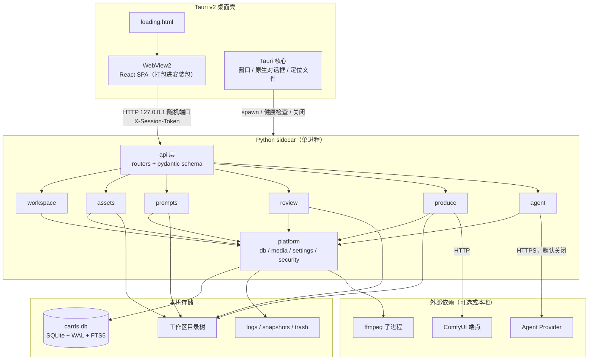
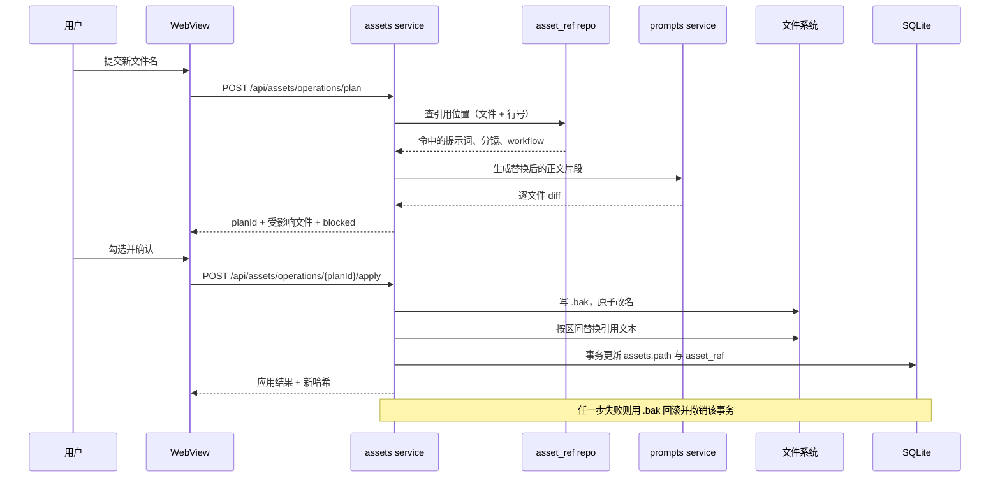
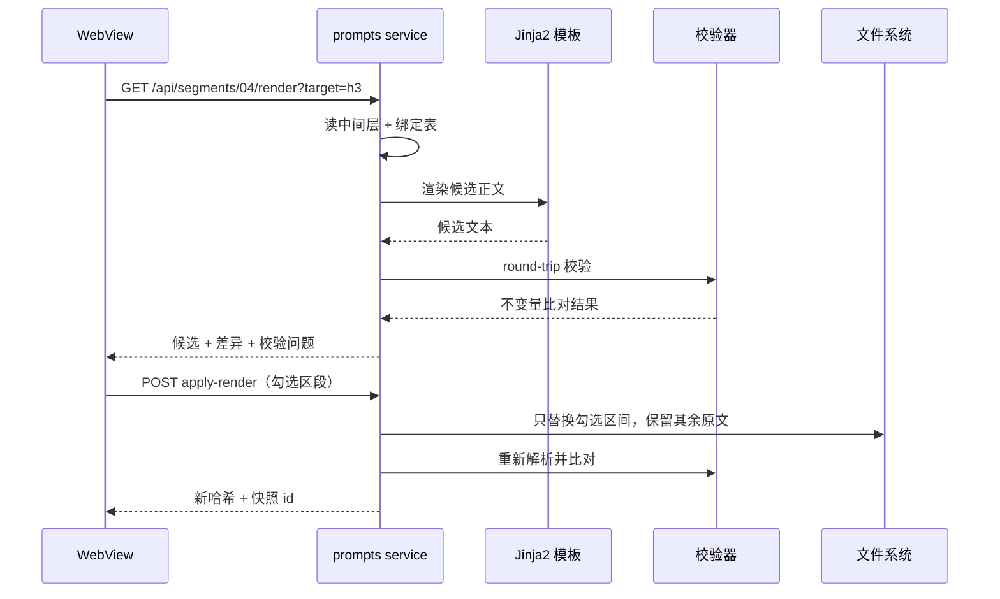
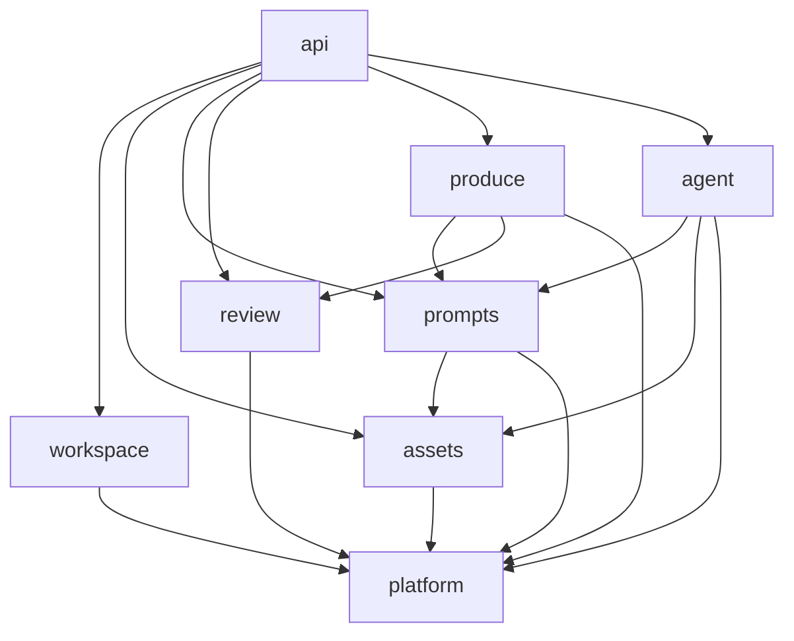
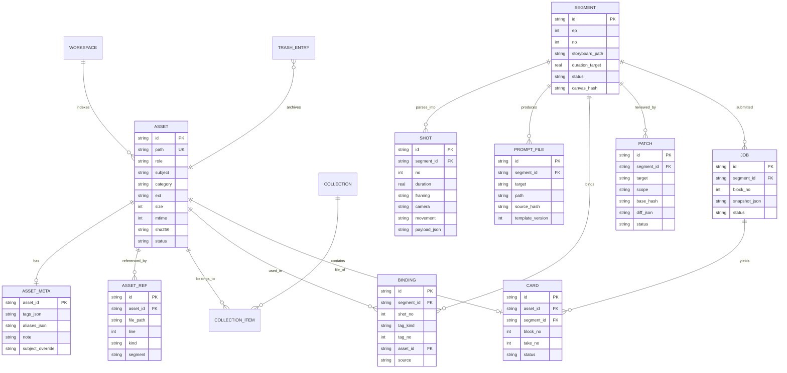
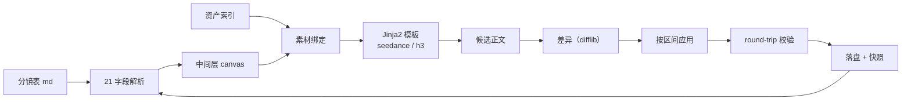
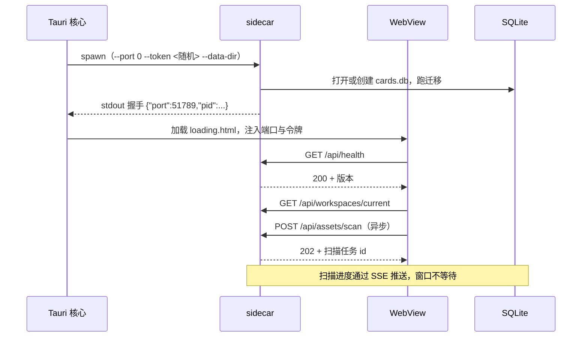
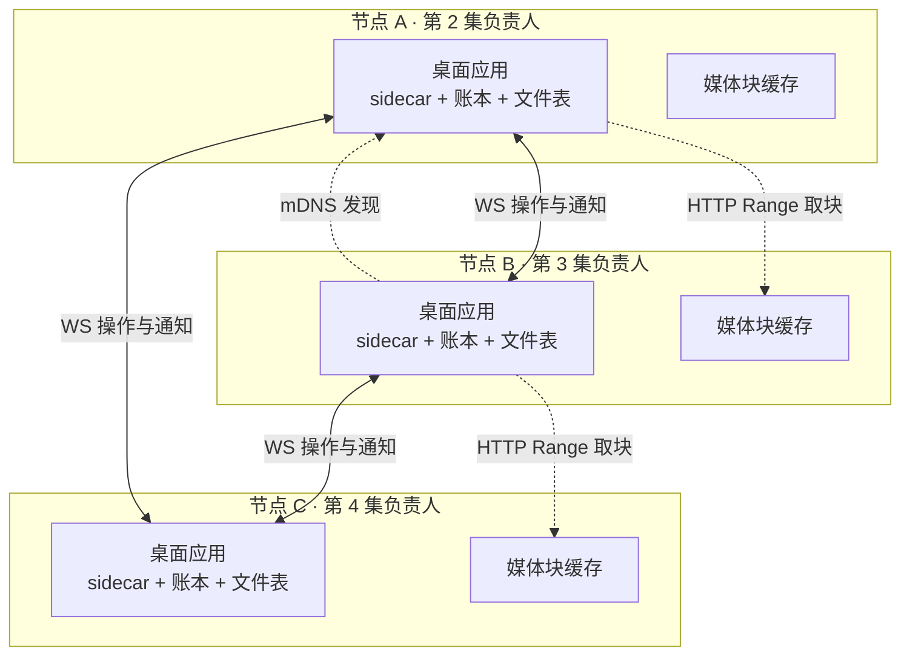
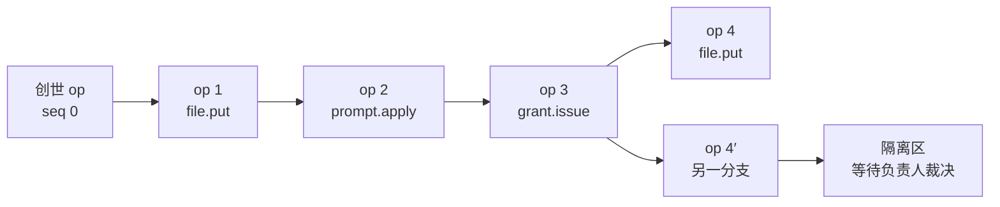
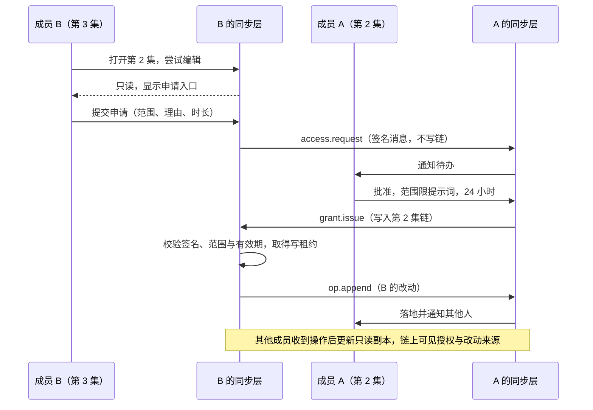

# GachaBench 技术架构（HLD）

日期：2026-10-22

状态：待评审

上游：`docs/REDESIGN-PRD.md`

## 1 设计概览

### 1.1 范围

本文覆盖 v1 重设后的运行时形态、模块边界与依赖方向、数据模型、接口契约、文本管线、前端结构、库选型，以及从现有代码过去的迁移路径。

不在本文范围内：导航与页面视觉（见 PRD §4–5）、各渲染模板的具体措辞、ComfyUI 节点图内部结构、模型参数调优、向量检索的实现。最后一项只预留表结构。

§12 描述 v2 的团队协作与局域网同步，v1 不启用。写进本文的原因是它会反向约束 v1 的几处基础设计：操作记录、稳定标识、内容哈希与文件表。这些接缝在 v1 就要留好，否则 v2 只能重做存储层。

### 1.2 需求回溯

| PRD 目标 | 设计回应 | 章节 |
| --- | --- | --- |
| 全工作区文件可检索、可看引用 | `assets` 模块承担索引、引用表与文件操作；FTS5 提供搜索 | §3.2 §5 |
| 分镜与素材转成中间层，再出两套提示词 | `prompts` 模块 + 原文区间改写管线 | §3.3 §6 |
| 审片时播放头、镜号、提示词镜块对齐 | `review` 模块维护块与镜的时间映射，前端共用同一份映射 | §3.4 §7.5 |
| 跑片降为制作动作 | `produce` 模块独立任务队列，不进一级导航的数据路径 | §3.5 |
| 旧工作区打开即用、不迁数据 | Alembic baseline 对齐现有表，只补列不搬数据 | §9 |
| v2 团队协作、按集授权、局域网同步 | 两级哈希链账本 + 内容寻址块存储 + 全网状 WS 传播；v1 预留操作记录与文件表 | §12 |

四条产品原则落到技术上各有一条对应：破坏性操作前出计划，对应 `assets` 的 plan/apply 两段式接口；生成结果先看 diff，对应 `prompts` 与 `agent` 的候选文本加差异结构；跨页跳转带上下文，对应路由参数与共享的段、镜标识；md 为真相，对应索引不存正文、改写只动区间。

### 1.3 约束

| 约束 | 来源 | 对设计的影响 |
| --- | --- | --- |
| 单机单用户，离线可用 | PRD §2.1、§3.1 `[Data-backed]` | 不引入需要独立进程的中间件；数据落在工作区目录 |
| Windows 10/11 优先，NSIS 安装 | 现有 `desktop/src-tauri/tauri.conf.json` `[Data-backed]` | 路径大小写、文件占用、长路径从设计阶段就要处理 |
| 提示词是 25–40KB 的 md，人工阅读与编辑 | 真实样本 `复试2/提示词/04_正片_第4段_15s.md` `[Data-backed]` | 文本处理必须保留原文，不做整篇重排 |
| 单个工作区文件量预期不超过一万 | 现状工作区规模 `[Hypothesis]` | 单库单表足够，分页与虚拟列表解决展示 |
| 首次索引不阻塞窗口可用 | 启动体验要求 `[Hypothesis]` | 索引异步，先返回目录骨架再补条目 |
| 不引入 Docker、容器与外部数据库 | PRD §2.2 `[Data-backed]` | 所有依赖随安装包分发，sidecar 自带运行时 |

### 1.4 术语

| 术语 | 含义 |
| --- | --- |
| 工作区 | 一个内容根目录，内含 `素材/`、`提示词/`、`分镜表/`、`原著/`、`草稿/`、`生成/` 等角色目录 |
| 角色目录 | 目录在业务里的用途，可配置别名，兼容 `素材`、`资产`、`assets` 三种命名 |
| 段 | 提示词工程的单位，对应一份分镜表 md 与一到两份提示词 md |
| 块 | 段按 5s 切出的片段，是跑片与审片的最小单位 |
| Take | 同一块的一次生成结果，即现有卡片 |
| 中间层 | 由分镜表解析出的结构化要素，是双目标渲染的唯一输入 |
| 目标 | 渲染目的地，Seedance 或 MiniMax H3 |
| 原文区间 | 正文中的字符偏移区间，所有改写以它为单位 |
| patch | Agent 的输出形式，包含区间、前文本、后文本与理由 |

## 2 总体架构

### 2.1 形态

桌面壳用 Tauri v2，界面是 React SPA，业务逻辑全部在 Python sidecar 里。sidecar 是 FastAPI 应用，以 PyInstaller 打成的可执行文件随安装包分发。内部按模块化单体组织：一个进程、一个数据库、六个业务模块，模块之间只通过 service 层调用。

选这一形态的直接原因是现有实现的连续性。后端 229 个单测、前端 19 个单测都建立在 FastAPI 与 React 上，Python 生态对 markdown、表格、图像与视频探测的支持最省力，重写成 Rust 或 Node 只会换来更长的迁移周期。Tauri 负责窗口、安装包、原生目录选择与文件定位，这些是浏览器做不了的部分。

图 1 是运行时视图。



界面始终从安装包内的静态资源加载，Tauri 保留 `tauri://` 来源，因此原生目录选择、在资源管理器中定位文件这类 IPC 能力照常可用。API 走独立的 HTTP 端口，浏览器里直接打开 `http://127.0.0.1:<port>/docs` 就能调试，不必经过桌面壳。

另一种做法是让 sidecar 顺便托管前端页面，同源可以省掉 CORS，但窗口会变成纯网页，Tauri 的原生对话框与 IPC 都要额外开口子。v1 不采用。

### 2.2 分层规则

| 层 | 允许做的事 | 禁止做的事 |
| --- | --- | --- |
| api | 解析请求、校验参数、把 service 结果转成响应模型、映射错误码 | 直接写 SQL、直接操作文件、包含业务分支 |
| service | 业务流程、事务边界、调用其他模块的 service | 依赖 FastAPI 的 Request 对象 |
| repo | 单表或单聚合的查询与写入 | 跨模块的业务判断 |
| platform | 数据库连接、迁移、媒体探测、配置、密钥、日志 | 知道自己被哪个业务模块调用 |

依赖方向固定为 api → service → repo，跨模块调用只走对方的 service。`platform` 被所有模块依赖，它自己不反向依赖任何业务模块，这一条保证依赖图无环。

### 2.3 关键路径

图 2 是改名的完整路径，它同时体现了计划、备份、重写与回滚四种机制如何串起来。



计划阶段不改任何文件，只算受影响范围。应用阶段先备份再动文件，数据库更新放在最后一个事务里。引用文本的替换由 `prompts` 模块按区间完成，`assets` 不直接拼字符串，这样替换规则只有一处实现。

图 3 是双目标渲染与应用。



渲染结果不直接落盘，先以候选形式返回，并附带与当前文件的差异。应用时只替换用户勾选的区间，未勾选的部分逐字保留，这也是 40KB 正文能被安全改写的关键。

## 3 模块设计

### 3.1 模块依赖



`prompts` 依赖 `assets` 只为一件事：按主体与别名查候选素材。`produce` 依赖 `prompts` 取提示词快照，依赖 `review` 登记产物卡片。`agent` 对 `prompts` 与 `assets` 都是只读，写入一律走自己的暂存区。

### 3.2 workspace

| 项 | 内容 |
| --- | --- |
| 责任 | 维护工作区注册、目录角色解析、设置持久化与会话生命周期 |
| 输入 | 打开或切换工作区的请求、设置页提交、启动参数 |
| 输出 | 工作区标识、角色目录到绝对路径的映射、当前设置快照 |
| 依赖 | platform（配置表、日志） |
| 边界 | 不扫描文件内容，不判断资产归属，不执行文件操作 |

角色目录解析兼容三种命名。配置里存的是角色到相对路径的映射，未配置时按顺序探测 `素材`、`资产`、`assets`。探测结果写入设置，后续打开不再重复探测。

### 3.3 assets

| 项 | 内容 |
| --- | --- |
| 责任 | 索引工作区文件，维护引用位置，执行带计划的文件操作 |
| 输入 | 扫描请求、文件监听事件、上传、改名或移动计划、回收站操作 |
| 输出 | 资产记录、引用列表、操作计划、逐文件 diff、去重与未引用结果 |
| 依赖 | workspace（目录映射）、platform（媒体探测、哈希、日志） |
| 边界 | 不生成提示词正文，不判断 take 的正片状态，不调用 ComfyUI |

索引以路径为唯一键，以资产 id 为稳定身份。改名时 id 不变，只更新路径与引用，这样标签、别名、集合成员、卡片关联都不受影响。扫描分两步：先用 `os.scandir` 建目录骨架，再按目录修改时间判断是否需要读取条目。已索引目录的 mtime 未变就跳过，这是增量扫描的依据。

引用索引记录的是「哪个文件的哪一行提到哪个资产」，来源限定三类：提示词 md 的文件名与标签表、分镜 md 的素材编号列、workflow json 的输入文件名。索引不推断语义，因此正文里出现的普通同名词不会建立引用。

文件操作统一走 `plan → apply → rollback` 三段。计划对象里每一项包含原路径、新路径、受影响引用与逐文件 diff；无法处理的项进 `blocked`，附原因（重名、非法字符、被占用）。应用前写 `.bak-<时间戳>`，替换用同目录临时名加 `os.replace`，保证同一卷内原子。Windows 上只改大小写时先改到临时名再改目标名。

### 3.4 prompts

| 项 | 内容 |
| --- | --- |
| 责任 | 把分镜表解析成中间层，完成素材绑定，渲染两个目标的提示词并安全写入 md |
| 输入 | 分镜表 md、提示词 md、资产绑定结果、渲染目标、Agent patch |
| 输出 | 中间层、候选正文、差异、校验结果、落盘后的新哈希与快照 |
| 依赖 | assets（候选素材）、platform（文件读写、哈希、模板配置） |
| 边界 | 不修改分镜表源文件，不重排标签编号，不调度跑片任务 |

解析、定位与拆分的既有规则整体搬入本模块，不改行为。`splitter.py` 的「只裁剪、只重编号、时间码重基」与 `prompt_locator.py` 的「`SH402` ↔ `[Shot 2]`、台词区间映射」直接成为模块内部实现，对外只暴露段、镜、块三种结果。

### 3.5 review

| 项 | 内容 |
| --- | --- |
| 责任 | 维护段、块、take 的浏览结构与时间码到镜号的映射，提供审片动作 |
| 输入 | 卡片查询、标记请求、导出请求、媒体探测结果 |
| 输出 | take 列表、镜边界表、导出文件、状态变更 |
| 依赖 | assets（文件路径与元信息）、platform（ffprobe 探测） |
| 边界 | 不生成视频，不改提示词正文，不裁切素材 |

时间映射由两个数组算出来：分镜表给出的每镜计划时长，与ffprobe 得到的实际片长。计划边界按累计时长生成，再整体缩放到实际片长。偏差超过 10% 时接口返回 `scaled: true`，前端据此显示标记，但映射本身照常可用。

### 3.6 produce

| 项 | 内容 |
| --- | --- |
| 责任 | 管理跑片任务，冻结提交时的上下文，回收产物为卡片 |
| 输入 | 段与块、参数覆盖、工作流选择、取消与重试请求 |
| 输出 | 任务状态与进度、日志尾部、入库卡片 |
| 依赖 | prompts（提示词快照）、review（卡片登记）、platform（HTTP 客户端、日志） |
| 边界 | 不解析提示词，不判断卡片好坏，不管理 ComfyUI 节点图 |

任务提交时把提示词正文、绑定素材列表、参数与工作流版本冻结成快照存进任务行。之后提示词再改，已提交的任务仍按快照执行。这一条让「重跑」成为可复现动作。

### 3.7 agent

| 项 | 内容 |
| --- | --- |
| 责任 | 调用外部模型生成 patch，管理补丁的生成、校验、过期与暂存 |
| 输入 | 段或镜范围、当前正文、中间层、诊断规则结果、Provider 配置 |
| 输出 | 结构化 patch、diff、状态流转 |
| 依赖 | prompts（只读正文与中间层）、assets（只读素材名称与标签）、platform（密钥、HTTP） |
| 边界 | 不写工作区文件，不改文件名与镜号，不跨段操作 |

patch 的结构固定为：目标段、目标范围（整段、镜号或 § 小节）、基准哈希、若干区间替换、理由与模型标识。应用时先比对基准哈希，不一致直接进入冲突状态。Provider 关闭时本模块不注册路由，接口返回 `PROVIDER_OFF`，前端把入口置灰。

### 3.8 platform

| 项 | 内容 |
| --- | --- |
| 责任 | 提供数据库连接与迁移、媒体探测、哈希、配置、密钥、日志、诊断包 |
| 输入 | 各模块调用 |
| 输出 | 会话、连接、探测结果、配置读写、结构化日志 |
| 依赖 | 无业务模块 |
| 边界 | 不含任何业务规则 |

媒体探测统一用 ffprobe 取时长、帧率、音轨数与编码，图片尺寸与缩略图用 Pillow。哈希对 2GB 以下文件算 sha256，超过阈值改用大小加修改时间的快速判重，并在资产记录上标注。

## 4 接口设计

### 4.1 通用约定

所有接口挂在 `/api` 下，请求与响应均为 JSON，文件流除外。除 `/api/health` 外，每个请求必须带 `X-Session-Token`，值由 Tauri 启动 sidecar 时生成并注入页面。令牌不写日志。

错误统一信封：

```json
{
  "error": {
    "code": "ROUNDTRIP_MISMATCH",
    "message": "镜数由 8 变为 7",
    "details": { "segment": "04", "fields": ["shotCount"] },
    "traceId": "01J..."
  }
}
```

列表查询用游标分页，参数 `cursor` 与 `limit`（默认 50，上限 200），返回 `{ "items": [...], "nextCursor": null }`。时间统一 ISO 8601 带时区。工作区内的路径统一用 POSIX 分隔符的相对路径，绝对路径只在本地打开与定位接口里出现。

### 4.2 接口总表

| 分组 | 方法与路径 | 用途 |
| --- | --- | --- |
| 系统 | `GET /api/health` | 存活与版本，不需要令牌 |
| 系统 | `GET /api/events` | SSE 推送任务进度、索引进度、文件变化、patch 创建 |
| 工作区 | `GET /api/workspaces` | 最近工作区列表 |
| 工作区 | `POST /api/workspaces/open` | 打开或切换工作区，返回角色目录映射 |
| 工作区 | `GET /api/workspaces/current` | 当前工作区与健康状态 |
| 资产 | `GET /api/assets` | 按角色、集合、关键词、类型筛选 |
| 资产 | `GET /api/assets/{id}` | 元信息、标签、别名、引用位置 |
| 资产 | `PATCH /api/assets/{id}` | 改标签、别名、主体覆盖、类别 |
| 资产 | `POST /api/assets/import` | 上传并落位，返回命名结果 |
| 资产 | `POST /api/assets/scan` | 触发增量扫描，可指定目录 |
| 资产 | `GET /api/assets/collections` | 内置与自定义集合 |
| 资产 | `POST /api/assets/operations/plan` | 改名、移动、删除的计划 |
| 资产 | `POST /api/assets/operations/{planId}/apply` | 应用计划 |
| 资产 | `POST /api/assets/operations/{planId}/rollback` | 撤销本次会话内的应用 |
| 资产 | `GET /api/assets/duplicates` | 重复分组 |
| 资产 | `GET /api/assets/unreferenced` | 未被引用的文件 |
| 资产 | `POST /api/assets/{id}/restore` | 从回收站恢复 |
| 资产 | `DELETE /api/assets/{id}` | 移入回收站，需先有 plan |
| 媒体 | `GET /api/media?path=` | 按路径取流，支持 Range |
| 媒体 | `GET /api/thumb?path=&w=` | 缩略图，带缓存 |
| 提示词 | `GET /api/segments` | 段列表，含状态与镜数 |
| 提示词 | `POST /api/segments/{seg}/parse` | 解析分镜，返回中间层与缺失项 |
| 提示词 | `GET /api/segments/{seg}/canvas` | 取中间层缓存 |
| 提示词 | `PUT /api/segments/{seg}/canvas` | 保存要素修改，标记未写入正文 |
| 提示词 | `PUT /api/segments/{seg}/bindings` | 手动绑定或忽略 |
| 提示词 | `GET /api/segments/{seg}/render?target=` | 渲染候选与差异 |
| 提示词 | `POST /api/segments/{seg}/apply-render` | 按区间应用候选 |
| 提示词 | `GET /api/segments/{seg}/file?target=` | 取正文与哈希 |
| 提示词 | `PUT /api/segments/{seg}/file` | 保存正文，服务端做 round-trip 校验 |
| 提示词 | `POST /api/segments/{seg}/validate` | 单独跑校验 |
| Agent | `GET /api/agent/providers` | Provider 列表与状态，密钥掩码 |
| Agent | `POST /api/agent/providers/test` | 连通性测试 |
| Agent | `POST /api/agent/patches` | 发起生成、诊断或对话调整 |
| Agent | `GET /api/agent/patches?segment=` | 待审 patch |
| Agent | `POST /api/agent/patches/{id}/apply` | 应用选中的区间 |
| Agent | `POST /api/agent/patches/{id}/reject` | 拒绝 |
| 审片 | `GET /api/cards` | 按段、块、状态筛选 |
| 审片 | `GET /api/cards/{id}` | 卡片详情与时间映射 |
| 审片 | `PATCH /api/cards/{id}` | 标记正片、废稿、备注、标签 |
| 审片 | `POST /api/cards/{id}/export` | 导出单条或批量 |
| 审片 | `GET /api/segments/{seg}/takes` | 段内块与 take 树 |
| 制作 | `GET /api/jobs` | 队列，按状态筛选 |
| 制作 | `POST /api/jobs` | 提交任务，含快照与参数 |
| 制作 | `POST /api/jobs/{id}/cancel` | 取消排队或请求中断 |
| 制作 | `POST /api/jobs/{id}/retry` | 原样重试 |
| 制作 | `GET /api/health/comfy` | 端点、ffmpeg、工作流映射状态 |
| 设置 | `GET /api/settings` | 分组读取，密钥掩码 |
| 设置 | `PUT /api/settings` | 分组保存，越界拒绝 |
| 搜索 | `GET /api/search?q=` | 跨资产、段、镜号、标签，按类型分组 |

### 4.3 关键契约

计划接口是文件安全的入口，契约必须完整。

| 字段 | 值 |
| --- | --- |
| Operation | `POST /api/assets/operations/plan` |
| Purpose | 计算改名、移动或删除的完整影响面，不改任何文件 |
| Auth | `X-Session-Token` |
| Request body | `kind`（`rename` / `move` / `delete`，必填）；`assetId`（string，必填）；`newName`（string，`rename` 必填，不含路径分隔符）；`toDir`（string，`move` 必填，工作区相对路径）；`options`（object，可选，`{ includeWorkflows: boolean }`，默认 true） |
| Success response | `200`；`{ planId, kind, items: [{ assetId, from, to, refs: [{ file, line, before, after, kind }] }], blocked: [{ assetId, reason }], stats: { files, refs } }` |
| Error codes | `400 PATH_INVALID`、`400 NAME_INVALID`、`404 ASSET_NOT_FOUND`、`409 NAME_CONFLICT`、`409 FILE_BUSY`、`423 WORKSPACE_READONLY` |
| 幂等性 | 不幂等；同一计划重复调用会生成新 planId，旧计划 30 分钟后失效 |

渲染接口返回候选而不落盘，这是双目标能并存的前提。

| 字段 | 值 |
| --- | --- |
| Operation | `GET /api/segments/{seg}/render?target=h3` |
| Purpose | 由中间层渲染指定目标的候选正文，返回差异与校验结果 |
| Auth | `X-Session-Token` |
| Path params | `seg`（两位段号，必填） |
| Query | `target`（`seedance` / `h3`，必填）；`baseHash`（string，可选，用于确认基于哪一版正文） |
| Success response | `200`；`{ target, candidate, baseHash, diff: [{ op, startLine, lines }], validation: { ok, issues: [{ code, shot, message }] }, templateVersion }` |
| Error codes | `404 SEGMENT_NOT_FOUND`、`404 TEMPLATE_MISSING`、`409 CANVAS_STALE`、`422 PARSE_PARTIAL` |
| 幂等性 | 幂等；同一中间层、同一模板版本、同一 baseHash 输出相同 |

patch 应用接口承担冲突检测。

| 字段 | 值 |
| --- | --- |
| Operation | `POST /api/agent/patches/{id}/apply` |
| Purpose | 把选中的区间写入目标 md，写前校验源哈希 |
| Auth | `X-Session-Token` |
| Request body | `expectedSourceHash`（string，必填）；`hunkIds`（string[]，必填，至少一项）；`target`（`seedance` / `h3`，必填） |
| Success response | `200`；`{ applied: true, newHash, snapshotId, validation: { ok, issues } }` |
| Error codes | `404 PATCH_NOT_FOUND`、`409 PATCH_CONFLICT`、`409 PATCH_EXPIRED`、`403 PATCH_SCOPE`、`422 ROUNDTRIP_MISMATCH` |
| 幂等性 | 不幂等；已应用的 patch 再次调用返回 `409 PATCH_APPLIED` |

### 4.4 错误码

| 码 | HTTP | 含义 | 前端处理 |
| --- | --- | --- | --- |
| `TOKEN_INVALID` | 401 | 令牌缺失或不匹配 | 显示连接失效，请求重启 sidecar |
| `WORKSPACE_NOT_OPEN` | 409 | 尚未打开工作区 | 跳转工作区选择 |
| `PATH_INVALID` | 400 | 路径越出工作区或含非法字符 | 标红输入框 |
| `NAME_INVALID` | 400 | 文件名违反 Windows 规则 | 标红输入框 |
| `NAME_CONFLICT` | 409 | 同名文件已存在 | 建议追加序号 |
| `FILE_BUSY` | 409 | 文件被其他进程占用 | 提示关闭播放器或 ffmpeg 后重试 |
| `PLAN_STALE` | 409 | 计划生成后磁盘已变 | 重新生成计划 |
| `ASSET_NOT_FOUND` | 404 | 资产不存在或已被彻底清除 | 刷新列表 |
| `PARSE_PARTIAL` | 422 | 分镜表缺少可解析列 | 进入部分解析状态，允许手工补 |
| `CANVAS_STALE` | 409 | 中间层与源文件不一致 | 提示重新解析 |
| `ROUNDTRIP_MISMATCH` | 422 | 保存后不变量不一致 | 阻止保存，展示差异位置 |
| `PATCH_CONFLICT` | 409 | 源文件在 patch 生成后被改 | 进入冲突状态 |
| `PATCH_EXPIRED` | 409 | 超过 24 小时 | 提示重新生成 |
| `PATCH_SCOPE` | 403 | patch 越出允许范围 | 拒绝并记录 |
| `PROVIDER_OFF` | 503 | Provider 未配置或不可用 | 入口置灰 |
| `COMFY_OFFLINE` | 503 | ComfyUI 不可达 | 禁用提交，任务继续轮询 |
| `JOB_DUPLICATE` | 409 | 同段同块已有排队任务 | 提示并允许强制提交 |
| `MEDIA_UNSUPPORTED` | 415 | 编码不被 WebView 支持 | 提示转码或外部打开 |
| `DISK_FULL` | 507 | 磁盘空间不足 | 中止写入，保留临时文件清理 |

### 4.5 契约的生成与版本

后端是 OpenAPI 的唯一来源，前端用 `openapi-typescript` 生成类型，用 `openapi-fetch` 发请求。生成动作接在构建脚本里，接口变更后类型不同步会直接编译失败。

应用不对外网开放，接口不做多版本并存。破坏性变更跟随安装包版本号，旧路由别名保留一个阶段，阶段结束后删除。

## 5 数据设计

### 5.1 存储边界

每个工作区一个 SQLite 库，位置沿用 `.gachabench/cards.db`，开启 WAL、`busy_timeout=5000` 与外键约束。

文件系统是内容真相，数据库是索引与元信息。资产记录可以从磁盘重建，重建时会丢掉标签与别名；其余数据不能重建。据此把表分成两类：

| 类别 | 表 | 备份策略 |
| --- | --- | --- |
| 可重建 | `assets`、`asset_ref`、FTS 索引 | 不备份，删除后重扫 |
| 不可重建 | `asset_meta`、`collection*`、`segment`、`shot`、`binding`、`prompt_file`、`patch`、`job`、`card`、`op_log`、`trash_entry` | 每日首次打开时快照，保留 7 份 |

快照写入 `.gachabench/snapshots/YYYYMMDD.db`，用 SQLite 的在线备份接口生成，不做整文件复制。

### 5.2 实体关系



实体与 PRD §6.1 的对象一一对应，没有为查询方便额外抽象实体。`ASSET_META` 单独成表，是为了让重扫可以整体重建 `ASSET` 与 `ASSET_REF` 而不丢用户标注。

### 5.3 表摘要

| 表 | 关键字段 | 说明 |
| --- | --- | --- |
| `workspaces` | id、root、roles_json、last_opened | 最近工作区，跨库使用一个小型配置库 |
| `assets` | id、path、role、subject、category、size、mtime、sha256、status | 一份文件一条，`path` 唯一 |
| `asset_meta` | asset_id、tags_json、aliases_json、note、subject_override | 用户标注，重扫不受影响 |
| `asset_ref` | asset_id、file_path、line、kind、segment | 引用位置，`kind` 取 filename、path、tag_table、workflow |
| `collections` | id、name、kind、filter_json | 内置集合与自定义集合 |
| `collection_items` | collection_id、asset_id | 手动包含项 |
| `segments` | id、ep、no、storyboard_path、duration_target、status、canvas_hash | 段状态与中间层版本 |
| `shots` | segment_id、no、duration、framing、camera、movement、payload_json | 21 字段中可结构化的部分放列，其余进 JSON |
| `bindings` | segment_id、shot_no、tag_kind、tag_no、asset_id、source、ignored | 编号不回收，解除绑定置 `ignored` |
| `prompt_files` | segment_id、target、path、source_hash、template_version | 一目标一份 |
| `render_profiles` | target、template_name、template_version、variables_json、enabled | 模板配置，可导入导出 |
| `patches` | segment_id、target、scope、base_hash、diff_json、status、expires_at | 同一段同时只有一个 pending |
| `jobs` | segment_id、block_no、snapshot_json、params_json、status、log_tail | 快照冻结 |
| `cards` | asset_id、segment_id、block_no、take_no、status、note、duration、fps | 沿用现有表名，只补列 |
| `op_log` | kind、plan_id、payload_json、result、created_at、seq、prev_hash、op_hash、actor | 操作日志，保留 30 天；后四列 v1 即写入，v2 直接升级为账本条目（见 §12.3） |
| `trash_entries` | asset_id、original_path、trash_path、deleted_at、restored_at | 回收站 |
| `snapshots` | segment_id、target、path、hash、created_at | 正文快照，保留 30 天 |
| `asset_vec` | asset_id、dim、vector | 语义检索预留，v1 不写入、不查询 |

### 5.4 索引策略

| 索引 | 服务对象 |
| --- | --- |
| `assets(path)` 唯一 | 路径查找与重扫对齐 |
| `assets(role, subject)` | 角色树与主体归组 |
| `assets(sha256)` | 重复检测 |
| `asset_ref(asset_id)` | 打开文件时列引用 |
| `asset_ref(file_path)` | 应用改名时反查受影响文件 |
| `segments(ep, no)` 唯一 | 段定位 |
| `shots(segment_id, no)` 唯一 | 镜定位 |
| `cards(segment_id, block_no, take_no)` | 审片台树 |
| `jobs(status, created_at)` | 队列 |
| `patches(status, expires_at)` | 待审与过期清理 |
| `asset_fts`（FTS5） | 文件名、主体、标签、别名的全文搜索 |

一万行量级下无需额外索引，表扫描代价可接受。JSON 字段不建索引，筛选在应用层做。

### 5.5 一致性与事务

SQLite 单写者，写入串行化。每个工作区持有一个 `asyncio.Lock`，写事务在锁内提交，事务体内不做网络调用与文件复制。

文件操作与数据库更新的顺序固定为：写备份、改文件、改引用文本、最后在一个事务里更新 `assets` 与 `asset_ref`。事务失败时用备份还原文件并在 `op_log` 记失败，界面提示可重试。反过来先改库再改文件，会让索引指向不存在的路径。

删除只写 `status` 并移动文件，不删行。彻底清除在二次确认后删行并删文件，同时清 `asset_ref` 与 `collection_items`。

`asset_fts` 用应用层同步维护，不用触发器。理由是重扫时需要整批重建，应用层更容易保证一致，也便于在迁移时一次性重建。

### 5.6 迁移

现有库由 `backend/db.py` 的 `SCHEMA` 字符串与 `_MIGRATIONS` 补列维护。新实现用 SQLAlchemy 2.0 声明模型配合 Alembic，第一步生成与现有表结构一致的 baseline，对已有工作区执行 `alembic stamp`，不重建表。

新增字段一律可空，旧版本忽略未知列仍能打开。迁移失败时后端进入只读模式，界面显示原因与备份位置，不阻止用户导出文件。

旧库不迁数据，旧卡片与资产记录原样保留，新增字段由首次扫描补齐。`cards` 与 `jobs` 两个表名沿用，避免重命名带来的迁移风险。

## 6 文本管线

### 6.1 原则

提示词正文以 md 文件为准，数据库只存解析结果、哈希与绑定关系，不存正文副本。所有改写都是对原文字符区间的替换，没有被选中的区间逐字保留。

这条原则解决三件事：40KB 正文不会因为一次保存被重新序列化；双目标渲染互不干扰；Agent 的 patch 可以精确到一句。

### 6.2 数据流



解析结果回到解析器再比对一遍，这是唯一能发现「改坏了」的位置。校验不通过就不写盘。

### 6.3 中间层结构

| 区块 | 字段 | 来源 |
| --- | --- | --- |
| 段落信息 | 集、段、目标时长、画幅、帧率、风格 | 分镜表抬头、设置 |
| 镜列表 | 镜号、景别、摄法、机位、运镜、时长、画面、动作、台词、音效、光线、色彩、道具、服装、特效、节拍、风险、素材编号 | 分镜表 21 字段 |
| 素材 | 编号、类型、资产 id、文件名、主体、状态（已绑定、待绑定、忽略） | 绑定结果 |
| 音频 | 台词段、音效、`<Audio N>` 映射 | 分镜表与提示词 §⑤ |
| 否定项 | 禁止出现的内容 | 分镜表风险列与设置 |

镜号与素材编号在中间层是稳定键，任何编辑都不改它们。要素视图允许改时长、画面描述这类内容字段，改完标记 `dirty`，渲染时才生效。

### 6.4 解析

`markdown-it-py` 只用于读：把 md 切成 token 流，定位 § 标题、GFM 表格与代码围栏，再在代码围栏内按行切 `[Shot N]`。写回不经过它，避免序列化器重排空白与表格对齐。

表格按 GFM 行解析，列数不足或表头不匹配时返回 `PARSE_PARTIAL` 与缺失列名，界面进入部分解析状态。解析结果带源文件哈希，源文件变化后中间层标记 `stale`。

### 6.5 定位

标签到镜块的映射沿用现有规则，直接迁入：`SH402` 取后两位对应 `[Shot 2]`；台词编号经 §⑥ 拆镜行映射，支持 `#13-#14` 区间；混写按逗号、顿号、空格切分。行号来自 `splitlines` 的绝对偏移，与编辑器显示一致。

`<Picture N>`、`<Subject N>`、`<Audio N>` 的编号只在新增素材时追加，解除引用留空不回收。这条规则写进渲染器与校验器两处，任一处违反都会被 round-trip 拦住。

### 6.6 渲染

每个目标一份 Jinja2 模板，模板文件名与版本号存在 `render_profiles`。模板上下文只有中间层与少量设置项，模板里不读文件、不发请求，保证渲染是纯函数。

Seedance 模板输出连续描述段落，H3 模板输出 §①–§⑥ 结构与标签体系。两套模板共用中间层，因此字段口径只有一处。

### 6.7 应用与校验

应用时按 hunk 逐个替换，替换范围必须在正文允许区段内（§① 至 §⑥，以及头部元信息中的指定行）。允许区段由解析器给出，越界请求返回 `PATCH_SCOPE`。

落盘前的 round-trip 不变量：

| 不变量 | 判定 |
| --- | --- |
| 段数、镜数 | 与原文件一致 |
| `<Picture N>` 与 `<Subject N>` 编号集合 | 不新增、不缺失、不重排 |
| 代码围栏数量与位置 | 一致 |
| 各 § 标题存在且顺序不变 | 一致 |
| 镜时长合计与段落目标时长的偏差 | 不超过 0.1s，超出只警告 |
| 绑定表与正文编号 | 一一对应，不一致阻止保存 |

任一项不通过则整次写入取消，原文件保持不变，返回差异位置。

### 6.8 冲突与快照

正文的每次写入先记录 `source_hash`，写后生成快照（文件名带时间戳，保留 30 天）。Agent 的 patch 带基准哈希，应用前比对；外部编辑导致不一致时进入 `PATCH_CONFLICT`，不覆盖。

同一段同时只允许一个 pending patch。新请求会先把旧 patch 标为过期，避免两个 diff 互相覆盖。

### 6.9 性能

单段正文 40KB，解析为一次 token 化加若干正则扫描，目标在 50ms 内完成 `[Hypothesis]`。渲染是字符串模板拼接，代价与镜数线性相关。差异计算用 `difflib.SequenceMatcher` 按行比对，40KB 文本的耗时在百毫秒级，放到线程池执行，不阻塞事件循环。

## 7 前端

### 7.1 路由

| 路径 | 页面 | 说明 |
| --- | --- | --- |
| `/assets` | 资产库 | 查询参数带 `role`、`collection`、`q`、`view` |
| `/prompts` | 段列表 | 查询参数带 `ep`、`status`、`q` |
| `/prompts/$seg` | 三栏工作台 | 查询参数带 `tab`、`target`、`shot` |
| `/review` | 审片台 | 查询参数带 `seg`、`block`、`take`、`compare` |
| `/produce` | 制作 | 查询参数带 `job` |
| `/settings` | 设置 | 查询参数带 `group` |
| `/` | 重定向到 `/assets` | |

旧路由 `/gacha`、`/split`、`/locate`、`/assets-old`、`/novels`、`/search` 保留重定向一个阶段，指向新页面对应查询参数。

段、镜、目标、时间码都放在 URL 查询参数里，跨页跳转只传参数，不靠全局状态传值。这样刷新、前进后退与从审片台跳提示词都走同一条路径。

### 7.2 数据层

服务端状态全部交给 TanStack Query，查询键按「资源 + 参数」构造，例如 `['assets', { role, collection, q, cursor }]`、`['segment', seg, 'canvas']`。失效规则集中在少量 mutation 的 `onSuccess` 里：改资产失效资产与引用，应用渲染失效段、正文与卡片的关联视图。

请求用 `openapi-fetch` 搭配生成的类型，中间件统一注入令牌、把错误信封转成带 `code` 的异常，由全局错误处理决定提示方式。表单用 `zod` 定义校验，`react-hook-form` 驱动设置页与落位弹窗。

### 7.3 状态划分

| 状态 | 位置 | 例子 |
| --- | --- | --- |
| 服务端数据 | TanStack Query 缓存 | 资产列表、段详情、任务队列 |
| 可分享的界面状态 | 路由查询参数 | 当前段、当前镜、渲染目标、播放时间码 |
| 短暂本地状态 | Zustand | 面板宽度、多选集合、播放器瞬时状态 |

播放器的 `currentTime` 不放进 Query，也不放进 URL，每个播放实例自己持有；只有在用户点击镜号或复制链接时才写入查询参数。

### 7.4 编辑与列表

正文编辑用 CodeMirror 6，差异视图用 `@codemirror/merge`。选择它的原因是包体小、按需加载语言包、支持大文档增量渲染，且能与只读模式共用同一套主题。Monaco 功能更全但体积与首次加载代价不合适。

分镜表用 TanStack Table 加 TanStack Virtual，列可折叠，行高固定。资产网格用虚拟滚动，缩略图懒加载。拖放落位与集合排序用 dnd-kit，键盘可达。全局搜索用 cmdk，`Ctrl+K` 唤起，结果按资产、段、镜号、标签分组。

### 7.5 播放器

播放用 Video.js。双联对比时取主播放器为时钟源，副播放器在 `timeupdate` 与 `seeking` 时对齐，音频只保留主画面。逐帧步进按 ffprobe 返回的帧率换算秒数。

时间码到镜号的映射由后端给出，前端只做区间二分。播放头进入新镜时更新右栏高亮；点击镜号发 `seek` 并写入查询参数，不重新请求段数据。

WebView2 支持的编码取决于系统安装的解码器，H.265 等格式可能无法播放 `[待确认]`。遇到 `MEDIA_UNSUPPORTED` 时提供「外部播放器打开」与「转码为 H.264 预览」两个操作，转码只在本地临时目录生成，不写回工作区。

### 7.6 进度推送

前端在应用加载后建立一条 `EventSource`，连 `GET /api/events`。事件类型包括 `job.updated`、`index.progress`、`file.changed`、`patch.created`、`trash.changed`。断线由浏览器自动重连，重连后拉一次全量状态对齐。

索引进度只驱动底部的进度条，不触发列表刷新；列表刷新由 `file.changed` 合并后触发，避免扫描过程中反复重排。

### 7.7 键盘

快捷键集中注册在一张表里，按页面作用域启用。编辑器聚焦时屏蔽全局单键，只保留 `Ctrl+S` 与 `Esc`。审片台的 `J/K/L`、`I/O`、`A/B` 只在播放器获得焦点时生效。

## 8 运行、并发与安全

### 8.1 启动序列



sidecar 由安装包内的可执行文件启动，端口取随机可用端口，令牌在每次启动时重新生成。握手失败或 5 秒内无输出时，窗口显示启动失败页与日志路径，可重试或打开日志目录。

运行期间 Tauri 每 5 秒请求一次 `/api/health`，连续三次失败则重启 sidecar，最多三次；仍失败则提示用户导出诊断包。退出时先请求 `/api/shutdown`，等待 3 秒，未退出则终止进程。

### 8.2 并发模型

| 工作 | 载体 | 说明 |
| --- | --- | --- |
| HTTP 请求 | asyncio 事件循环 | uvicorn 单 worker，接口本身薄 |
| 文件哈希、图像缩略、ffprobe | 线程池（`run_in_threadpool`） | 阻塞调用不占事件循环 |
| 全量扫描 | 单个后台任务 + 线程池 | 同一工作区同时只跑一个扫描 |
| 文件监听 | `watchfiles` 的独立线程 | 事件进入 asyncio 队列，合并后处理 |
| 跑片 | 进程内调度器 | 单队列，可配并发上限，默认 1 |
| ffmpeg 转码 | 子进程 | 通过 `asyncio.create_subprocess_exec`，可取消 |

进程内调度器不追求持久化队列。任务行本身就是队列，进程重启后把「运行中」改为「失败（进程中断）」，由用户决定重试。

### 8.3 写入控制

SQLite 写入在 `asyncio.Lock` 内串行。索引批量写入每 500 条提交一次，单次事务控制在毫秒级。长事务、事务内网络请求、事务内复制大文件都在评审时禁止。

并发读不设限，WAL 模式下读写不互斥。`busy_timeout` 设为 5000ms，超时返回 `DATABASE_BUSY`，前端提示重试。

### 8.4 文件监听

监听范围是工作区的角色目录，忽略 `.gachabench/`、`.bak-*`、`.tmp-*` 与转码临时目录。事件按 300ms 去抖后合并，同一路径只保留最后一次变更，然后触发增量扫描。

扫描期间如果又有事件，只标记「需要再扫」，等当前扫描结束后再跑一轮。外部编辑造成索引与磁盘不一致时，界面出现「有新变化」条，不自动覆盖用户正在编辑的元信息。

### 8.5 安全

| 面 | 措施 |
| --- | --- |
| 本机接口 | 只绑 `127.0.0.1`，随机端口，`X-Session-Token` 校验，令牌每次启动更新 |
| CORS | 只允许 `tauri://localhost`、`http://tauri.localhost` 与开发期的 `http://localhost:1420` |
| 路径 | 所有路径参数先 `resolve`，再判断是否在工作区根之下，越界直接拒绝 |
| 密钥 | 存 Windows 凭据管理器（`keyring`），不落工作区；接口只返回末四位 |
| 日志 | 结构化 jsonl，路径与段名可记，正文与密钥不记 |
| 上传 | 单文件大小上限可配，默认 2GB；扩展名白名单；落位前检查非法字符 |
| 网页能力 | CSP 限制脚本来源为安装包资源，禁止外部脚本；不加载远程字体 |
| Agent | 默认关闭；开启后只发选中段正文与素材名称，发送前在界面列出范围 |

网络请求只出现在三处：ComfyUI 端点、Agent Provider、可选的书源采集。三处都有超时与取消，且都记录请求元信息（地址、耗时、状态码），不记录正文。

### 8.6 可观测性

日志写入 `.gachabench/logs/server-YYYYMMDD.jsonl`，保留 7 天。字段包括时间、级别、模块、事件、耗时、traceId。慢请求（超过 500ms）单独记一条 `slow_request`。

诊断包由设置页导出，内容为版本信息、配置（密钥掩码）、最近 200 条日志、数据库 `integrity_check` 结果、索引统计。不含正文与媒体文件。

## 9 迁移与分阶段替换

### 9.1 现有代码的去向

| 现有位置 | 去向 | 处理 |
| --- | --- | --- |
| `backend/db.py` | `platform/db` + Alembic | `SCHEMA` 作为 baseline 依据，手写迁移逻辑删除 |
| `backend/splitter.py` | `prompts/split` | 规则原样搬入，补单测覆盖已有样本 |
| `backend/prompt_locator.py` | `prompts/locate` | 同上，行号规则不变 |
| `backend/routers/assets.py` | `assets/api` | 扩展为全工作区索引，上传命名规则保留 |
| `backend/routers/` 中的卡片与任务路由 | `review/api`、`produce/api` | 路径调整，旧别名保留一个阶段 |
| `web/src/components/Rail.tsx` | 新侧栏 | 7 项改 5 项 |
| `web/src/pages/GachaBoard.tsx` | `review` 页面 | 卡片墙改成段、块、take 三列 |
| `web/src/pages/AssetLibrary.tsx` | `assets` 页面 | 主体分组扩展为角色树加集合 |
| `desktop/src-tauri` | 不变 | 增加 sidecar 握手与健康检查 |

`splitter.py` 与 `prompt_locator.py` 的现有测试直接迁移为模块单测，保证搬迁不改行为。

### 9.2 阶段与架构落点

| 阶段 | 架构改动 | 完成标志 |
| --- | --- | --- |
| P0 | 新路由树、侧栏、Query 客户端、OpenAPI 生成链路 | 五个入口可达，旧页面可重定向 |
| P1 | `assets` 索引与引用表、FTS5、增量扫描、`GET /api/assets` | 能找到任一文件与引用位置 |
| P2 | plan/apply/rollback、备份、回收站、`prompts` 的区间替换 | 验收标准 3、4 通过 |
| P3 | 分镜解析、中间层、绑定表、部分解析状态 | 验收标准 5 通过 |
| P4 | Jinja2 双模板、渲染候选、差异、round-trip | 验收标准 6 通过 |
| P5 | Agent Provider、patch 表、冲突检测 | 验收标准 7、10 通过 |
| P6 | 时间映射接口、播放器、双联同步、SSE | 验收标准 8 通过 |
| P7 | 任务快照、调度器、产物回收 | 验收标准 9 通过 |
| P8 | 旧别名下线、性能与冲突处理、诊断包 | 全部验收标准通过 |

每个阶段结束时安装包可运行。未完成的入口不注册路由，界面隐藏，不出现半成品页面。

### 9.3 兼容与回滚

旧 API 别名与旧前端路由保留一个阶段。别名实现为同一 handler 的第二个路径，不复制逻辑。

数据库只增列、只增表。旧版本安装包忽略新列仍能打开工作区，代价是看不到新增元信息。升级前自动快照，降级时提示用户从快照恢复。

sidecar 可执行文件与前端静态资源同版本发布，版本号在 `/api/health` 里返回，桌面壳启动时比对，不一致直接提示重装，不允许混搭。

### 9.4 风险

| 风险 | 概率 | 影响 | 应对 |
| --- | --- | --- | --- |
| 区间替换误伤未选文本 | 中 | 正文被改坏 | 只替换勾选 hunk；写前写后哈希；round-trip 拦截；快照可回滚 |
| 索引与磁盘不一致 | 中 | 列表显示不存在的文件 | 引用与路径双层校验；「有新变化」条；重扫幂等 |
| SQLite 写锁竞争 | 低 | 请求变慢或超时 | 写串行化、短事务、批量提交、busy_timeout |
| WebView2 编码支持不全 | 中 | 部分视频不能预览 | 外部播放器与临时转码两条退路 |
| PyInstaller 打包遗漏依赖 | 中 | 安装后启动失败 | 构建后跑冒烟脚本，检查 ffmpeg、Pillow、模板目录是否在包内 |
| 旧库结构漂移 | 低 | 迁移失败 | baseline 以现有 `SCHEMA` 为准；迁移失败转只读并保留备份 |
| Agent 输出结构不合格 | 中 | patch 无法应用 | 服务端 schema 校验，不合格直接丢弃并提示重试 |

## 10 技术选型

### 10.1 原则

单机离线是第一约束，凡是需要独立服务、容器或云账号的组件一律不选。第二约束是迁移成本，已在用且够用的库不替换。第三约束是打包体积与启动时间，桌面安装包要把 Python 运行时、ffmpeg 与前端资源都装进去。

### 10.2 后端

| 用途 | 选定 | 替代方案 | 理由 |
| --- | --- | --- | --- |
| 运行时 | Python 3.12 | Node、Rust | 现有后端与测试都在 Python；md、表格、图像、视频探测的库最全 `[Expert judgment]` |
| Web 框架 | FastAPI | Flask、Django | 现有实现沿用；自带 OpenAPI，前端类型可从契约生成 `[Data-backed]` |
| 数据校验 | Pydantic 2 | attrs、marshmallow | 与 FastAPI 同源，请求、响应、配置共用一套模型 `[Expert judgment]` |
| 数据访问 | SQLAlchemy 2.0 | 原始 sqlite3、Peewee | 表数量到二十余张后需要统一的事务与关系表达；2.0 的 typed 写法与 Pydantic 配合顺 `[Expert judgment]` |
| 迁移 | Alembic | 手写 `_MIGRATIONS` | 现有补列方式在表增多后难追踪；Alembic 可生成 baseline 并保留升级链 `[Expert judgment]` |
| 数据库 | SQLite（WAL + FTS5） | PostgreSQL、DuckDB | 单用户单机，零运维；FTS5 满足文件名与标签搜索 `[Data-backed]` |
| 全文搜索 | FTS5 | Meilisearch、Elasticsearch | 数据量小，独立搜索服务会多一个进程与一份数据 `[Expert judgment]` |
| 文件监听 | watchfiles | watchdog | 基于 Rust 的通知库，Windows 上事件更稳，接口是异步生成器 `[Expert judgment]` |
| 模板 | Jinja2 | 手写字符串拼接 | 两套目标需要可配置模板，模板要能导入导出 `[Expert judgment]` |
| Markdown 读取 | markdown-it-py | mistune、markdown | 只读解析，token 流完整，GFM 表格可用；写回不经过它 `[Expert judgment]` |
| 差异 | difflib | 自研 diff | 标准库，行级差异足够展示；不需要字符级合并 `[Expert judgment]` |
| Agent | pydantic-ai | LangChain、LiteLLM、自写 HTTP | 结构化输出与工具调用直接映射到 patch schema，Provider 可换，依赖面小 `[Expert judgment]` |
| HTTP 客户端 | httpx | requests | 现有依赖；异步与超时控制统一 `[Data-backed]` |
| 图像 | Pillow | OpenCV | 只需尺寸与缩略图，OpenCV 体积过大 `[Expert judgment]` |
| 视频探测 | ffprobe / ffmpeg | PyAV | 已随包分发，命令行可控、可取消；转码复用同一份二进制 `[Expert judgment]` |
| 哈希 | hashlib | xxhash | 标准库够用；大文件走快速判重，不需要额外依赖 `[Expert judgment]` |
| 密钥 | keyring | 自写加密文件 | 直接落到 Windows 凭据管理器，避免自制加密 `[Expert judgment]` |
| 打包 | PyInstaller（onedir） | Nuitka、嵌入式 Python | 现有方案；onedir 启动快，便于把模板与 ffmpeg 一起带上 `[Data-backed]` |
| 测试 | pytest | unittest | 现有 229 个用例基于 unittest 风格，pytest 可直接运行并补 fixture `[Data-backed]` |
| 签名与密钥（v2） | cryptography | PyNaCl | Ed25519 签名、密钥序列化与自签证书都在一个库里，维护活跃 `[Expert judgment]` |
| WebSocket（v2） | Starlette 内置 + uvicorn `[standard]` | 独立 aiohttp 服务 | 现有栈已含 websockets 实现，不必再起一个服务 `[Data-backed]` |
| 局域网发现（v2） | zeroconf | 手输 IP、UDP 广播 | mDNS 在 Windows 与 macOS 都能用；手输地址作为回退 `[Expert judgment]` |
| 块传输（v2） | HTTP Range + httpx | 全走 WS 二进制帧 | 大文件传输不被控制消息阻塞，断点续传直接用 Range `[Expert judgment]` |
| 规范化序列化（v2） | 标准库 json（排序键、紧凑分隔符） | orjson、msgpack | 哈希要对字节稳定，标准库行为最可预期 `[Expert judgment]` |

### 10.3 前端与桌面

| 用途 | 选定 | 替代方案 | 理由 |
| --- | --- | --- | --- |
| 桌面壳 | Tauri v2 | Electron | 现有实现；安装包小，WebView2 由系统提供 `[Data-backed]` |
| 框架 | React 19 + TypeScript | Vue、Svelte | 现有代码与组件库都在 React `[Data-backed]` |
| 构建 | Vite | webpack | 现有实现；开发期热更新快 `[Data-backed]` |
| 样式 | Tailwind 4 + shadcn/radix | MUI、Ant Design | 现有实现；组件可改源码，视觉与 PRD 的三栏布局贴合 `[Data-backed]` |
| 路由 | TanStack Router | React Router | 查询参数是一等公民，类型安全的 search schema 正好承载段、镜、目标 `[Expert judgment]` |
| 服务端状态 | TanStack Query | SWR、自写缓存 | 现有代码已用 Query；失效规则集中，SSE 事件可直接触发 `[Data-backed]` |
| 接口类型 | openapi-typescript + openapi-fetch | 手写类型、tRPC | 后端是 FastAPI，OpenAPI 免费得到；类型与实现同源，改接口即编译报错 `[Expert judgment]` |
| 表单 | zod + react-hook-form | 手写校验 | 设置页与落位弹窗字段多，schema 可同时用于前后端提示 `[Expert judgment]` |
| 编辑器 | CodeMirror 6 + @codemirror/merge | Monaco | 40KB 正文与差异视图，CM6 体积小、可按需加载、移动端与桌面一致 `[Expert judgment]` |
| 播放器 | Video.js | 原生 `<video>`、hls.js | 需要逐帧、区间循环、双实例同步与统一控件；Video.js 的插件与 API 成熟 `[Expert judgment]` |
| 列表 | TanStack Virtual + Table | AG Grid | 资产网格与分镜表都需要虚拟滚动；AG Grid 授权与体积都不合适 `[Expert judgment]` |
| 拖放 | dnd-kit | react-beautiful-dnd | 维护活跃，支持键盘与自定义碰撞 `[Expert judgment]` |
| 命令面板 | cmdk | 自写 | 全局搜索的键盘交互直接可用 `[Expert judgment]` |
| 本地界面状态 | Zustand | Redux | 现有实现；只存面板与播放器瞬时状态 `[Data-backed]` |
| 前端测试 | Vitest + Testing Library | Jest | 与 Vite 同配置，无需额外转译 `[Expert judgment]` |
| 端到端 | Playwright | Tauri WebDriver | 可直接跑 `vite preview` 加真实 sidecar，覆盖 API 与界面联调 `[Expert judgment]` |

### 10.4 不选的项目

| 候选 | 不选的原因 |
| --- | --- |
| PostgreSQL | 需要独立服务与安装步骤，与单机零安装冲突；语义检索的需求用 FTS5 与预留表结构承接 |
| Redis | 没有跨进程缓存与队列需求，进程内调度器足够 |
| Celery | 需要 broker，单机单队列用不上 |
| 微服务拆分 | 一个用户、一个数据库，拆开只增加部署与调试成本 |
| Electron | 安装包与内存占用都高于 Tauri，现有壳已可用 |
| 全 Rust 重写 | 文本与媒体处理的迁移成本远超收益，PyInstaller 已能满足分发 |
| Monaco | 功能过剩，首次加载与包体代价大，diff 需求由 CM6 merge 覆盖 |
| LiteLLM / LangChain | 只为调一个 Provider 引入整层抽象；pydantic-ai 的结构化输出更贴 patch schema |
| sqlite-vec 扩展 | v1 不做语义检索，只留表；打包扩展会引入平台与签名问题 |
| Meilisearch / Elasticsearch | 万级数据与简单筛选用不上独立搜索服务 |
| 自写状态管理 | Query 加少量 Zustand 已覆盖，多一层抽象没有收益 |
| Hyperledger Fabric / 自建链平台 | 需要容器、证书体系与排序节点，和单机安装包、局域网直连都冲突；本项目只需要可验证的操作历史 |
| libp2p | 面向公网与 NAT 穿透，局域网全网状用 WS 直连即可 |
| Automerge / Yjs 等 CRDT | 按集授权已经保证单集单写者，冲突面不在文本合并；引入 CRDT 会把 md 原文改成二进制文档模型，与 md 为真相冲突 |
| IPFS | 只用内容寻址的块目录，不需要 DHT 与公网网关 |

## 11 错误处理

### 11.1 分类

| 类别 | 例子 | 处理方式 | 用户看到 |
| --- | --- | --- | --- |
| 输入错误 | 非法文件名、越界参数、路径穿越 | 请求层拒绝，返回具体字段 | 输入框标红与原因 |
| 状态冲突 | 计划过期、源文件已改、patch 冲突 | 拒绝写入，返回当前状态 | 提示重新生成或对比 |
| 外部依赖失败 | ComfyUI 离线、Provider 超时、磁盘满 | 中止当前动作，保留已有数据 | 明确原因与重试入口 |
| 程序缺陷 | 未捕获异常 | 记日志与 traceId，返回 500 | 通用错误页与诊断包入口 |
| 数据损坏 | 库完整性检查失败、迁移失败 | 转只读，保留备份 | 只读横幅与备份位置 |

### 11.2 关键失败路径

| 场景 | 行为 |
| --- | --- |
| 改名中途失败 | 用 `.bak` 还原已改文件，撤销该事务，`op_log` 记失败，界面列失败文件 |
| 渲染应用后校验失败 | 不写盘，返回差异位置，原文件字节不变 |
| 任务运行中 sidecar 崩溃 | 重启后把运行中任务标为失败（进程中断），保留快照可重试 |
| 索引扫描中断 | 已写入的条目保留，任务状态标为中断，下次扫描从上次目录继续 |
| SSE 断线 | 浏览器自动重连，重连后拉一次全量状态对齐 |
| 媒体文件被外部删除 | 卡片保留并标 `missing`，播放器显示占位与路径，提供重扫 |
| Provider 返回不合 schema | 丢弃本次输出，保留原文，提示重试，不解析半成品 |

### 11.3 待确认

- 各库的具体版本号在开发前锁定，本文不写版本，避免与真实依赖漂移。
- WebView2 对目标工作区常用编码的支持范围，需要拿真实成片样本验证。
- Seedance 是否需要独立的上传表与编号体系，影响模板上下文，不影响中间层结构。
- 现有 40KB 级提示词样本数量是否够做 round-trip 回归，PRD §8.5 尚未定论。
- Tauri 外部 HTTP 来源下的原生对话框调用方式，需要在壳里做一次最小验证后再冻结启动序列。
- v2 的媒体是否也要全量落盘。当前按「元信息全量 + 媒体按需」设计，改全量只需要调整预取策略。
- 项目发起人的身份是否允许转交，转交时项目链的写权限如何交接。
- 局域网内是否需要传输加密。默认明文加签名，能发现篡改但不能防窃听。

## 12 团队协作与局域网同步（v2）

### 12.1 范围

v2 开启后仍是同一个安装包，启动时选择「本机模式」或「加入项目」。三项能力同时上线：可验证的操作历史、按集划分的写权限、局域网内自动同步。

两个选择合并后的口径是：每个节点持有全量逻辑副本，包括项目链、各集链、文件表、文字文件与缩略图；视频、音频、大图这类媒体块按需拉取并缓存。这样每个人离线也能看到别人负责的集的全部文字内容与结构，但不会为了看一段视频把几百 GB 拉到本地。协议对文字与媒体一视同仁，以后要求媒体全量，只需改预取策略。

不在范围内：代币与挖矿、公链、跨项目共享、公网穿透、独立中心服务器、多人同时编辑同一段正文。

### 12.2 拓扑



每个节点跑同一套 sidecar，里面多一个同步服务。v2 把同步服务做成 `sync` 模块，与六个业务模块平级，只依赖 `assets`（文件表与哈希）、`workspace`（路径）与 `platform`（密钥、存储），不调用 `prompts` 或 `produce`，避免同步链条牵动业务逻辑。项目发起人只比常人多一项权限：项目链的写者。任何一台机器关机，其他人照常工作，重启后补齐缺口。

成员之间全网状直连，连接数随人数按平方增长，八人以内没有问题。更多人时改为指定一台机器做消息中继，账本结构不变。

发现方式优先用 mDNS（服务类型 `_gachabench._tcp`），失败则手动填地址与端口。Windows 首次运行会弹防火墙授权，设置页提供「网络诊断」，显示监听端口、已连接成员与最近一次握手结果。

### 12.3 账本

账本分两级。项目链一份，记录成员、集归属、项目公共资产与设置，只有发起人写。集链每集一份，记录文件变更、提示词应用、素材元信息与卡片状态，只有该集当前的写者写。



分两级的原因是避开全局共识。每集只有一个写者，集链天然串行；项目级信息写得少，由发起人串行追加即可。跨集操作不存在，也就不需要排序。

每条操作的字段：

| 字段 | 说明 |
| --- | --- |
| `opId` | 操作哈希，等于下文的 `hash` |
| `chainId` | `proj` 或 `ep:03` |
| `seq` | 从 0 递增，创世为 0 |
| `prevHash` | 上一条操作的哈希 |
| `actor` | 成员 id |
| `lamport` | 逻辑时钟，收到远端操作时取 `max(local, remote) + 1` |
| `wallClock` | 本机时间，仅供参考，冲突裁决不用它 |
| `type` | 操作类型 |
| `payload` | 类型对应的内容 |
| `hash` | `sha256` 规范化 JSON（键排序、无多余空白） |
| `signature` | 用成员私钥对 `hash` 的 Ed25519 签名 |

`wallClock` 不参与判定，避免成员改系统时间。冲突时按 `lamport` 比较，相同则比较 `opId`，规则固定，任何节点算出的结果一致。

操作类型：

| 链 | 类型 | 内容 | 写者 |
| --- | --- | --- | --- |
| 项目 | `project.genesis` | 项目名、创建时间、发起人公钥 | 发起人 |
| 项目 | `member.join` | 成员公钥、显示名、邀请哈希 | 新成员签名，发起人链上接纳 |
| 项目 | `member.remove` | 成员 id、原因 | 发起人 |
| 项目 | `ep.assign` | 集号或区间、负责人 | 发起人 |
| 项目 | `ep.transfer` | 集号、原负责人、新负责人、双方签名 | 发起人与新负责人 |
| 项目 | `sharedAsset.meta` | 项目公共资产的标签、别名 | 发起人 |
| 项目 | `project.settings` | 渲染配置、目录角色 | 发起人 |
| 集 | `grant.issue` | 被授权人、范围、到期时间、申请哈希 | 集负责人 |
| 集 | `grant.release` | 授权 id、释放原因 | 被授权人 |
| 集 | `file.put` | 路径、新哈希、大小、基础版本哈希 | 当前写者 |
| 集 | `file.delete` | 路径、回收站位置 | 当前写者 |
| 集 | `file.restore` | 路径、来源哈希 | 当前写者 |
| 集 | `prompt.apply` | 目标、区间差异、基准哈希、快照 id | 当前写者 |
| 集 | `canvas.update` | 中间层字段变化 | 当前写者 |
| 集 | `asset.meta` | 集内资产的标签、别名、绑定 | 当前写者 |
| 集 | `card.mark` | 卡片状态、备注、拒收标签 | 当前写者 |
| 集 | `checkpoint` | 前 256 条的操作根与文件表根 | 当前写者 |

操作里只放元信息与哈希，不放文件字节。文件内容按哈希存进块目录，链上记录的是「哪个路径指向哪个哈希」。

每 256 条操作写一个检查点，内容是截至该 `seq` 的操作 Merkle 根与文件表 Merkle 根，附带签名。新节点加入或断线太久时，先取最新检查点，再补检查点之后的操作，无需从创世重放。

访问申请不写链。它是请求人签名的消息，在对等节点间转发并落进 `access_requests` 表；负责人的批准才写成 `grant.issue`，里面带申请哈希。这样申请不需要占用集链的写权限。

### 12.4 身份与授权

每个成员一对 Ed25519 密钥，私钥存 Windows 凭据管理器，条目名带上项目标识，避免多项目串用。公钥随 `member.join` 进项目链。

加入项目的流程：发起人生成一次性邀请，内容为项目标识、邀请 id、有效期；邀请以文本或链接发给对方。对方在自己的应用里填入邀请，生成密钥并签名 `member.join`，发起人在项目链上接纳。邀请只能用一次，用后标记失效。

集归属由 `ep.assign` 指定，一个人可以负责多集，一集只有一个负责人。转交需要原负责人与新负责人双方签名，缺一方不生效。

授权是一个签名凭证，字段如下：

| 字段 | 说明 |
| --- | --- |
| `grantId` | 凭证 id |
| `ep` | 集号 |
| `grantee` | 被授权成员 |
| `scopes` | 可做事项，取 `prompt`、`rename`、`delete`、`produce` |
| `issuedAt` / `expiresAt` | 有效期，单次最长 24 小时 |
| `requestHash` | 对应申请的哈希 |
| `nonce` | 防重放 |
| `signature` | 负责人签名 |

写权限按租约发放，同一集在同一 `seq` 上只有一个写者：默认是负责人，签发授权后是被授权人。租约期间负责人自己也不写这一集，界面显示「已借出，剩余 3 小时」。被授权人可以提前释放，释放后负责人立刻恢复写入。

负责人要提前收回时，广播一条签名的 `grant.revoke` 消息，所有节点立即拒绝该被授权人的后续操作，即使对方不配合也写不进别人的副本。链上补记在租约结束或释放后完成，保证链仍然单写者。

授权范围默认不含改名与删除，这两项要单独勾选。删除文件先进回收站，链上留删除操作与原路径，恢复是另一条操作。



读取不加限制。项目成员可以查看所有集的资产、分镜与提示词，这也是「互相查看」的实现方式。

项目公共资产（主角四视图、常用场景、风格参考）归发起人所有，所有人可引用，修改需发起人授权。集内资产跟随集归属，随集转交。

### 12.5 文件与同步

文件表以工作区相对路径为键，记录该路径当前的块哈希、大小、所属集与最后修改的操作 id。目录结构由路径推导，不单独存。

块按内容寻址，哈希用 sha256，分块 1 MiB，每块再存自己的哈希。相同内容只存一份，提示词改一句只产生一个新块，其余块命中缓存。块目录在 `.gachabench/blobs/<前两位>/<哈希>`。

同步策略：

| 对象 | 策略 |
| --- | --- |
| 自己负责的集 | 全部文件即时拉取，包括视频 |
| 别人负责的集 · 文字 | md、json、txt、yaml 即时拉取 |
| 别人负责的集 · 缩略图 | 即时拉取，单张限制在 256KB 以内 |
| 别人负责的集 · 媒体 | 打开播放器或图片查看器时拉取，边下边播，缓存保留 |
| 项目公共资产 | 文字与缩略图即时，媒体按需 |

控制消息走 WS，块传输走 HTTP。每个节点同时是 WS 服务端与客户端，监听端口在设置里可见。块接口支持 Range，断点续传按块补齐，取完校验整块哈希，不符则换一个持有者重取。

传播路径：本地操作先落盘、再入链、再广播 `op.append` 给所有已连接节点。收到的一方校验签名与 `prevHash` 后写入自己的副本，并继续转发给尚未收到的节点，`opId` 去重，转发深度限制为 3，避免环路。

补缺机制比广播可靠：每次握手交换各链的头部（`chainId`、`seq`、`hash`），之后每 30 秒再交换一次。发现落后就按 `ops.since` 批量拉取，批量上限 500 条；缺口过大时改取最近检查点。头部一致就认为同步完成。

新成员加入时拿到创世操作、最新检查点、检查点之后的操作与文件表，然后按上表拉取。进度显示在设置页与底部任务条。

缓存有配额，默认 50GB，超出按最近最少使用淘汰。自己负责的集、正在播放的文件、最近 7 天看过的文件不参与淘汰。

### 12.6 冲突与离线

单集单写者是主要的冲突预防手段。仍会出问题的场景与处理：

| 场景 | 检测 | 处理 |
| --- | --- | --- |
| 租约交接时两边都写了 | 同一 `chainId` 下同 `seq` 出现不同哈希 | 该集进入 `CHAIN_FORK`，暂停自动同步，两分支都保留；负责人签署一条裁决操作，选定一支，另一支移入隔离区 |
| 离线期间集被转交 | 提交时 `prevHash` 不在主链上 | 拒绝写入，本地改动保留为草稿，界面提示「该集已由他人接管」 |
| 两人同时点批准 | 两条 `grant.issue` 指向同一集 | 按 `lamport` 与 `opId` 排序，后到者无效并在界面标出 |
| 删除与改名交错 | 操作顺序与 `base_hash` 不一致 | 后一条操作因基础哈希不符被拒，界面给出现状与重试 |
| 成员改系统时间 | `wallClock` 异常 | 只用 `lamport` 裁决，时间仅用于显示 |
| 网络分区 | 长时间收不到对方头部 | 各写各的集，不影响；恢复后按链补齐 |
| 缓存块损坏 | 块哈希不符 | 丢弃该块，换持有者重取 |

分叉不自动合并。两份都可能是真实工作，静默合并会丢内容；交给负责人裁决，代价是一次人工确认，换来历史可追溯。

离线只允许编辑自己负责的集。被授权期间离线，先在本地排队，重连后校验租约仍有效再提交；租约过期则转草稿。

### 12.7 数据模型

v2 在 v1 基础上加这些表。`assets` 表兼任文件表，`sha256` 成为所有文件都有的字段。

| 表 | 关键字段 | 说明 |
| --- | --- | --- |
| `members` | id、pubkey、display_name、role、joined_at、status | 项目成员 |
| `member_devices` | id、member_id、pubkey、last_seen | 同一成员多台机器时区分来源 |
| `episode_owners` | ep、owner_member_id、assigned_at、assigned_by | 一集一行 |
| `grants` | grant_id、ep、grantee、scopes_json、issued_at、expires_at、revoked_at、op_id | 授权凭证 |
| `access_requests` | id、ep、requester、scopes_json、reason、status、created_at、decided_at | 申请与决定，不写链 |
| `operations` | op_id、chain_id、seq、prev_hash、actor、lamport、wall_clock、type、payload_json、signature | 账本，v1 的 `op_log` 升级而来 |
| `checkpoints` | chain_id、seq、ops_root、files_root、signature、created_at | 每 256 条一个 |
| `blobs` | hash、size、chunk_size、chunk_count、created_at、last_seen_at | 块索引，文件在磁盘上 |
| `manifests` | path、blob_hash、size、ep、owner_member_id、updated_at | 路径到块的映射，由操作推导 |
| `sync_state` | peer_id、chain_id、head_seq、head_hash、last_sync_at | 每个对端每链的进度 |
| `sync_queue` | id、peer_id、blob_hash、offset、state、updated_at | 断点续传 |

唯一约束：`operations(chain_id, seq)`、`blobs(hash)`、`manifests(path)`、`episode_owners(ep)`、`members(pubkey)`。`operations` 按 `chain_id, seq` 建索引，`manifests` 按 `ep` 建索引，够用。

本地数据库仍是每个工作区一份，团队模式下的工作区在项目根下，路径不变。

### 12.8 接口与协议

WS 握手分五步，握手完成后才允许交换操作：

| 步骤 | 方向 | 内容 |
| --- | --- | --- |
| `hello` | 双向 | 项目标识、成员 id、公钥、应用版本、监听端口 |
| `challenge` | 接收方 → 发起方 | 32 字节随机数 |
| `auth` | 发起方 → 接收方 | 对 `projectId + nonce + 对方公钥` 的签名 |
| `heads` | 双向 | 各链 `seq` 与 `hash` 的数组 |
| `ready` | 双向 | 进入正常消息流 |

正常消息：

| 类型 | 方向 | 内容 |
| --- | --- | --- |
| `op.append` | 推送 | 一条完整操作 |
| `op.batch` | 拉取响应 | 最多 500 条 |
| `head.announce` | 推送 | 某链新头部 |
| `blob.announce` | 推送 | 新块的哈希与大小 |
| `blob.need` | 请求 | 需要的块哈希列表 |
| `presence` | 推送 | 在线成员与正在编辑的集 |
| `grant.notice` | 推送 | 授权签发、释放或撤回 |
| `error` | 推送 | 错误码与原因 |

这类消息用 JSON，单条控制在 64KB 以内；超过的内容一律走块传输。

REST 侧新增：

| 方法与路径 | 用途 |
| --- | --- |
| `GET /api/team/members` | 成员列表与在线状态 |
| `POST /api/team/invites` | 生成一次性邀请 |
| `POST /api/team/join` | 用邀请加入项目 |
| `POST /api/team/owners` | 指定集负责人，转交需双方签名 |
| `GET /api/team/grants` | 当前授权与剩余时间 |
| `POST /api/team/grants` | 批准申请，写 `grant.issue` |
| `POST /api/team/grants/{id}/revoke` | 立即收回 |
| `GET /api/team/requests` | 待处理申请 |
| `POST /api/team/requests` | 发起申请 |
| `POST /api/team/requests/{id}/decide` | 批准或拒绝 |
| `GET /api/team/peers` | 对端连接、延迟、同步进度 |
| `GET /api/sync/status` | 各链头部、待传块、缓存占用 |
| `POST /api/sync/pause` | 暂停同步，用于排查 |
| `GET /api/sync/blob/{hash}` | 取块，支持 Range |

新增错误码：

| 码 | HTTP | 含义 |
| --- | --- | --- |
| `PROJECT_MISMATCH` | 409 | 对端属于另一个项目 |
| `MEMBER_UNKNOWN` | 403 | 成员不在项目链中 |
| `INVITE_INVALID` | 410 | 邀请过期或已使用 |
| `UNAUTHORIZED_WRITE` | 403 | 操作者对该集没有写权限 |
| `LEASE_HELD` | 409 | 该集已被借出，负责人暂不能写 |
| `GRANT_EXPIRED` | 403 | 授权已过期 |
| `CHAIN_FORK` | 409 | 检测到分叉，该集暂停同步 |
| `BLOB_MISSING` | 404 | 所有已连接节点都没有该块 |
| `BLOB_HASH_MISMATCH` | 422 | 收到的块与哈希不符 |
| `PEER_UNAVAILABLE` | 503 | 对端断线 |

### 12.9 v1 预留

v2 能否顺利接上，取决于 v1 的几处基础决定。这些在 v1 实现时就要落地，v2 不重做存储层。

| 接缝 | v1 的做法 | 不预留的后果 |
| --- | --- | --- |
| 操作是唯一变更入口 | 所有写操作经 service 生成 `op_log` 行，带 `seq`、`prev_hash`、`op_hash`、`actor` | 散落在各处的直接写库无法变成账本 |
| 稳定标识 | `assets.id`、`segments.id` 不随路径变，改名只改路径 | 改名后历史断链 |
| 内容哈希 | 每个文件都有 `sha256`，大文件也不例外 | 团队模式下无法判重与传输 |
| 操作带基础版本 | 文件写入与 patch 应用都带 `base_hash` | 冲突检测无从谈起 |
| 路径规范 | 统一 POSIX 相对路径 | 跨机器路径不一致 |
| 资产即文件表 | `assets` 覆盖工作区全部文件，不只素材 | 同步范围漏文件 |
| 身份可后置 | v1 不生成成员密钥；首次开启团队时生成并签创世 | 没有影响，密钥生成是独立步骤 |
| 所有者字段可空 | `segments.owner_member_id` 可为空 | 加列比改表结构省事 |

旧工作区第一次进入团队模式时，当前状态做成创世检查点，由发起人签名。v1 期间的 `op_log` 没有签名，作为未验证历史保留并标注来源，不参与链上校验。

### 12.10 信任边界

账本能证明「谁在什么时候改了哪一集、内容哈希是多少」，但不能证明所有节点都没合谋。把所有成员的副本一起改掉，任何本地校验都发现不了；这类系统没有全局真相，只有多数节点的一致性。多签检查点可以提高篡改成本，v2 不默认启用。

| 威胁 | 应对 |
| --- | --- |
| 改本地账本 | 与其他节点交换头部，哈希不符即被发现；该节点被标记为异常并暂停同步 |
| 冒名连接 | 握手签名挑战，公钥必须已在项目链中 |
| 未授权写入 | 每个节点本地校验操作者与授权，无权限的操作直接丢弃 |
| 重放旧操作 | `seq` 连续性与 `opId` 去重；授权带 `nonce` 与到期时间 |
| 投毒块 | 按块与整文件哈希校验，不通过就换源 |
| 窃听 | 默认明文 WS 加签名，能看到内容但改不了；需要保密时用项目自签证书开 TLS |
| 成员被移除后继续写 | `member.remove` 后所有节点拒绝其操作，历史保留可查 |
| 恶意节点大量推送 | 每对端限速，单批 500 条，超出则断开 |

### 12.11 阶段与风险

| 阶段 | 范围 | 完成标志 |
| --- | --- | --- |
| C0 身份与本地账本 | 密钥、签名、两级链、检查点，仍单机 | 同一操作重放得到同一哈希 |
| C1 操作同步 | 握手、头部交换、操作拉取与广播 | 两台机器改同一集的不同文件后互相看见 |
| C2 块同步 | 块存储、按需拉取、续传、缓存配额 | 一方播放另一方负责集的视频 |
| C3 权限与界面 | 集归属、申请、授权、租约提示、分叉裁决 | 未授权成员无法写入，授权到期自动收回 |
| C4 硬化 | 限速、诊断、移除成员、恢复流程 | 断网、关机、重连、分叉四类场景都有确定行为 |

| 风险 | 概率 | 影响 | 应对 |
| --- | --- | --- | --- |
| mDNS 被防火墙拦截 | 高 | 发现不到成员 | 手动地址兜底，设置页给诊断 |
| 分叉后人工裁决不熟悉 | 中 | 该集长时间停同步 | 界面给出两分支的文件差异与提交人，默认保留内容多的一支 |
| 媒体缓存撑爆磁盘 | 中 | 系统盘告急 | 配额、淘汰、可配置缓存目录 |
| 大文件首次同步慢 | 高 | 开始工作前等待 | 文字优先，媒体边用边下；显示单集进度 |
| 成员离线改动过期授权 | 中 | 提交被拒 | 本地留草稿，重连后可重新申请 |
| 项目链写者丢失密钥 | 低 | 无法再改归属 | 导出加密备份；恢复流程单列 |
| 全互联连接数过多 | 低 | 消息风暴 | 八人以上改中继拓扑 |
