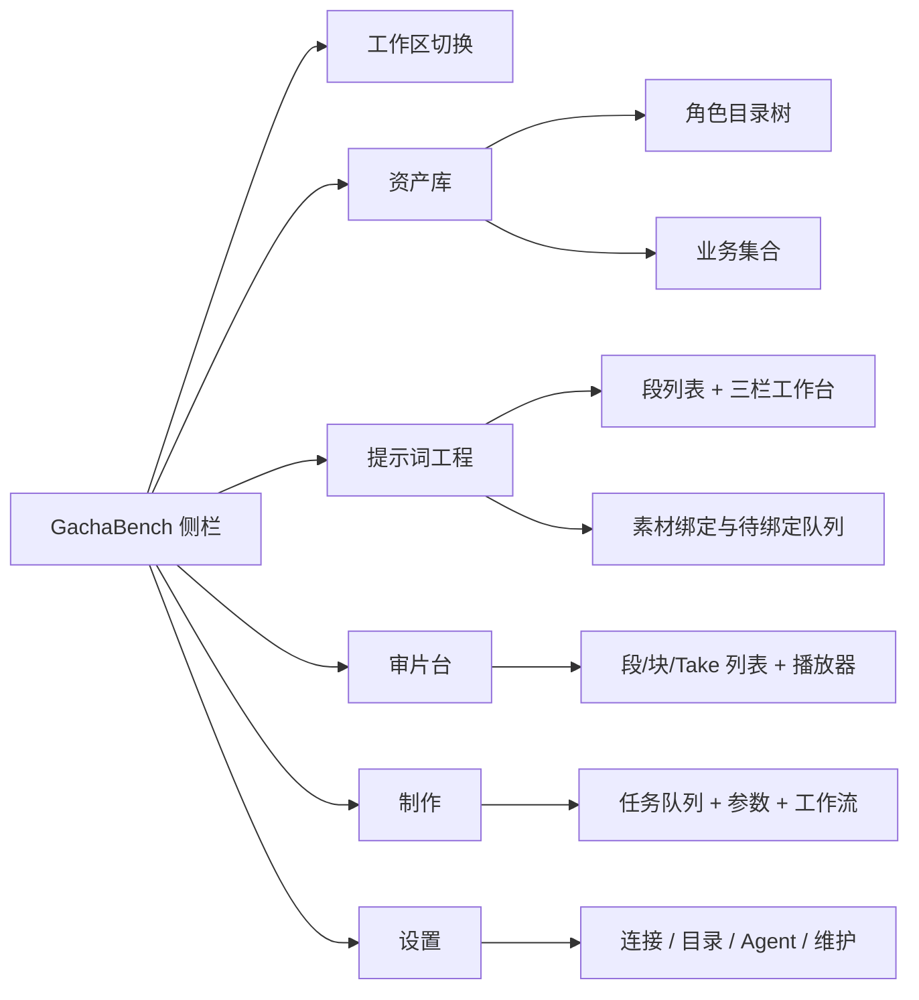
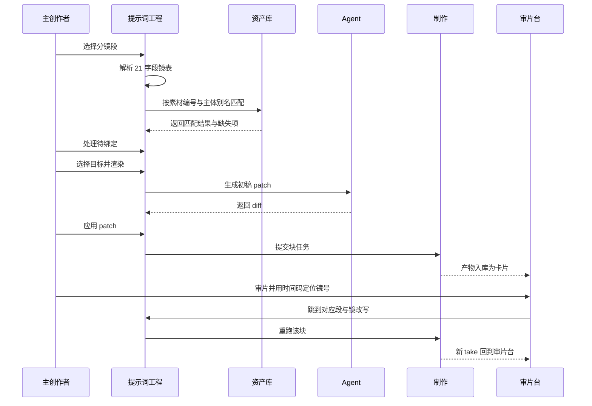
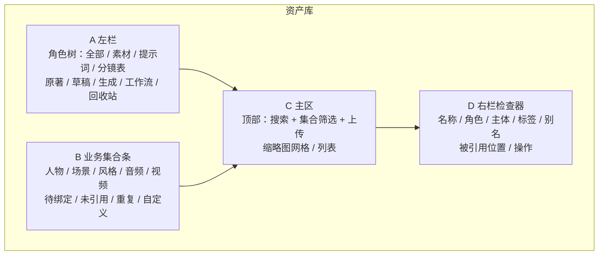
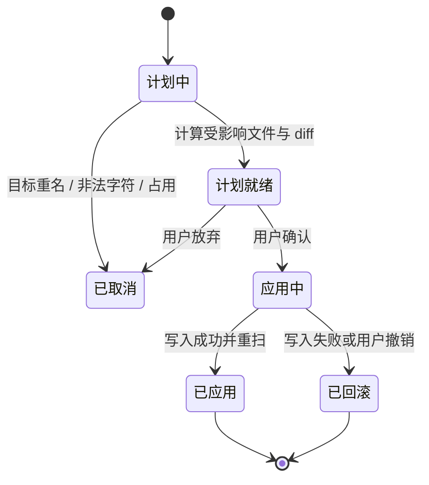
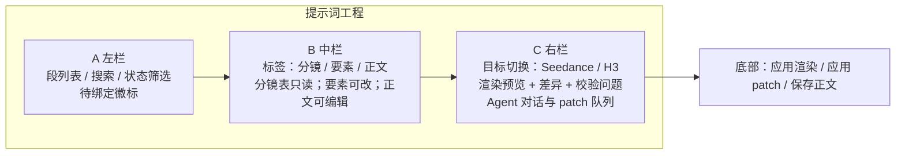
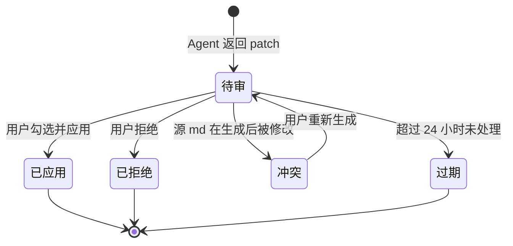
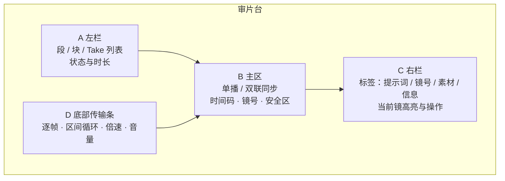
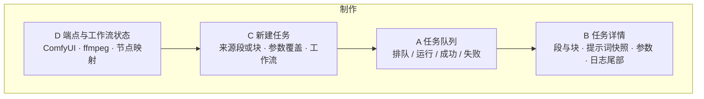
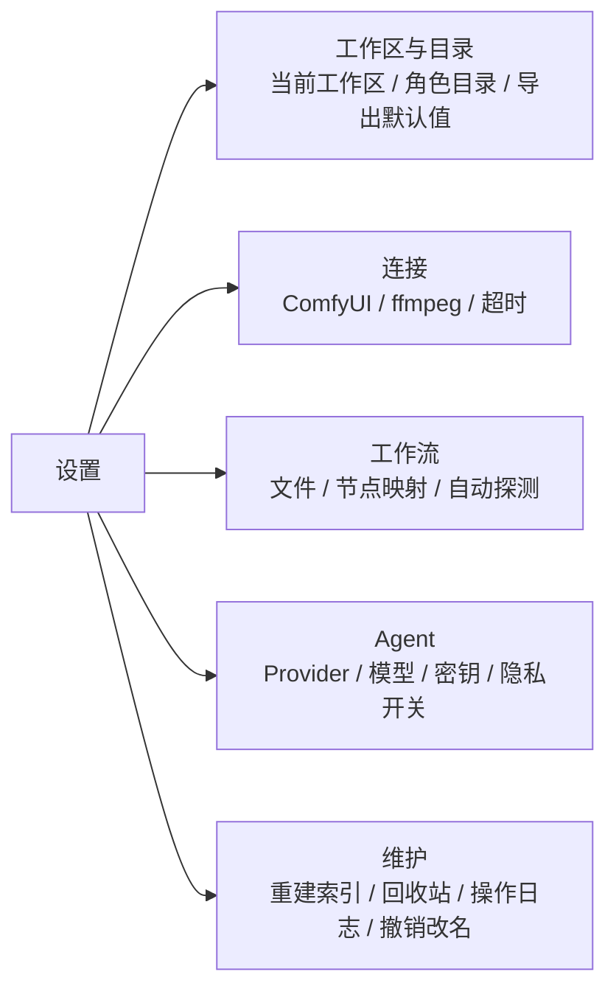

# GachaBench 产品重设 PRD

日期：2026-10-22

状态：待评审

## 1 背景

GachaBench 现在是一套围绕 ComfyUI 跑片长出来的工具集：抽卡台看结果，拆分台切 15s，定位工单改文本，资产管理收素材，原著库和小说搜索负责找文本。功能都在，入口按系统模块排，日常使用要在五个页面之间来回跳。

这次重设把优先级倒过来。跑片退到制作动作，资产管理和提示词工程成为两个主库，视频预览独立成审片台。理由来自现状里的三个具体问题。

### 1.1 现状与问题

| 问题 | 现状证据 | 影响 |
| --- | --- | --- |
| 资产只是附属目录 | 资产索引只扫 `素材/` 一个目录；分组靠文件名前缀判断人物、场景、风格 | 提示词、分镜表、原著、成片都在资产视野之外，找不到「这个人物在哪些段里被用过」 |
| 提示词缺少工程化载体 | 提示词是 25–40KB 的 md，§①–§⑥ 靠人读；素材以文件名硬编码在正文，例如 `<Picture 1> is 白陌_写实_四视图.png` | 改名就断引用；同一段要出 Seedance 与 H3 两套词时只能手抄，两份必然漂移 |
| 预览按卡片组织 | 抽卡台按段/块列卡，详情抽屉承担播放；时间码与镜号、提示词不联动 | 看到问题镜头后，要回定位页重新搜 `SH402` 才能改词，审片和改词是两件事 |
| 跑片占据一级入口 | 一级导航 7 项里，抽卡台与拆分台都围着生成转 | 生成不稳定时，主界面大半不可用；资产整理和提示词维护被挤到边角 |

证据来源：现有代码与真实工作区样本（`复试2/提示词/04_正片_第4段_15s.md`、`复试2/分镜表/分镜脚本_第12集第4段15s.md`）。标注为 `[代码与样本观察]`。

### 1.2 不解决的后果

素材越多，靠文件名记忆的成本越高；提示词越调越细，手抄两套目标的出错概率越大；审片与改词分家，同一段要改三次才能回到跑片。半年后工作区会变成一堆能跑但说不清来源的文件。

## 2 目标与边界

### 2.1 目标

1. 一个工作区里的所有文件，都能在资产库按角色目录和业务集合两种视角找到，并看到它被谁引用。
2. 分镜与素材能自动转成一份规范中间层，再分别渲染 Seedance 与 MiniMax H3 两套提示词，正文仍以 md 落盘。
3. 审片时播放头、镜号、提示词镜块三方对齐，看到问题能直接对那一镜发起改写或工单。
4. 跑片降为制作台里的任务动作，不再占用主界面。
5. 旧工作区不做数据迁移，打开即用。

量化目标在基线采集后补齐，见 §7.1。

### 2.2 不做的事

- 不做 ComfyUI 节点图编辑器。节点图仍由 ComfyUI 本体负责。
- 不做视觉模型自动诊断。审片仍由人判断，诊断只做规则校验。
- 不默认把素材或提示词上传云端。Agent 默认关闭，开启后也只发送选中的段。
- 不做多人协作与权限体系。v1 仍是单机单用户。
- 不迁移旧数据，不改现有工作区目录结构与 `cards.db`。

## 3 用户与场景

### 3.1 用户

| 角色 | 特征 | 使用频率 | 决策范围 |
| --- | --- | --- | --- |
| 主创作者（唯一角色） | 熟悉分镜与提示词，能判断表演与画面；接受命令行与本地部署 | 每天，连续 2–6 小时 | 资产命名、提示词定稿、正片与废稿判定、是否启用云端 Agent |

单人使用意味着不需要角色权限矩阵，但需要所有破坏性操作可回滚。`[假设 — 待确认]` 若后续出现协作者，再补只读与评论权限。

### 3.2 核心场景

1. 新开一段：选分镜 md，解析出镜表，补齐缺失素材绑定，选目标，生成初稿，逐镜改，定稿。
2. 整理素材：导入一批人物图，按主体归类，发现重名与未引用文件，批量改名并确认引用修复。
3. 审片：打开某段的三块候选，双联对比两条 take，发现 SH402 手部穿插，跳到该镜提示词改一句，重跑。
4. 查来源：点开一张成片，看到它由哪份提示词、哪组素材、哪次任务跑出。
5. 收素材：从原著库或联网书源导入文本，切章后作为提示词上游。

## 4 信息架构

### 4.1 一级导航

一级导航从 7 项收敛为 5 项，按「你在做什么」划分。

### 4.2 旧入口去向

| 旧入口 | 新位置 | 处理方式 |
| --- | --- | --- |
| 抽卡台 | 审片台 | 卡片墙改为段/块/Take 列表，保留状态标记与筛选 |
| 拆分台 | 提示词工程 + 制作 | 拆分与块预览留在提示词工程，提交动作进制作 |
| 定位工单 | 提示词工程 + 审片台 | 文本定位留在提示词工程，画面定位进审片台，共用镜号 |
| 资产管理 | 资产库 | 扩展为全工作区索引 |
| 原著库 | 资产库 > 原著 | 作为角色目录与导入入口 |
| 小说搜索 | 资产库 > 导入 > 联网采集 | 采集仍默认关闭，保留免责声明 |
| 设置 | 设置 | 增加 Agent Provider 与索引维护 |

### 4.3 全局外壳

侧栏顶部保留工作区切换与健康状态。全局搜索（`Ctrl+K`）同时搜文件、段、镜号与标签，结果按类型分组，选中后跳到对应页面并带上下文。任务条固定在底部，显示正在跑的任务、进度与失败提示，可从任意页面展开。

### 4.4 主流程

三条交互原则贯穿全产品：破坏性操作先出计划再确认，生成类结果先看 diff 再应用，跨页跳转默认带上段与镜的上下文。

## 5 功能需求

### 5.1 功能总表

| # | 模块 | 功能说明 |
| --- | --- | --- |
| 1 | 资产库 | 索引工作区内全部文件，按角色目录与业务集合浏览；支持搜索、筛选、缩略图与列表两种密度；右侧检查器显示元信息、标签、别名、引用位置与可执行操作。 |
| 2 | 资产导入与整理 | 支持拖放上传、批量导入、按「主体_用途」落名与自动去重；自动归类人物、场景、风格、音频、视频，允许手动覆盖；识别重复文件与未引用文件。 |
| 3 | 文件操作 | 允许改名、移动、删除、恢复到回收站；操作前生成计划，列出受影响的提示词、分镜表与工作流文件；应用前展示逐文件 diff；被引用文件删除时先显示影响面。 |
| 4 | 引用修复 | 维护文件名到引用位置的索引；改名或移动后自动重写正文中的文件名，支持整批应用与本次会话内回滚；外部目录中的引用只提示不修改。 |
| 5 | 提示词工程 | 以段为单位列出分镜表；解析 21 字段镜表为规范中间层；展示镜、要素、正文三视图；每段有未解析、待绑定、已渲染、待确认、已定稿五种状态。 |
| 6 | 素材绑定 | 按镜表素材编号、人物名、场景名与别名自动匹配资产；未匹配项进入待绑定队列；手动绑定优先并记录来源；`<Picture N>`、`<Subject N>`、`<Audio N>` 编号一经生成不再重排。 |
| 7 | 双目标渲染 | 从同一中间层分别渲染 Seedance 与 MiniMax H3 两套提示词；右侧并排预览两套结果与当前 md 的差异；应用只写当前目标的 md，另一目标不受影响。 |
| 8 | Agent | 提供生成初稿、规则诊断、对话式调整三种动作；所有输出都是 patch，必须先看 diff 再决定应用或拒绝；Agent 不能改文件名、镜号顺序、其他段。 |
| 9 | 审片台 | 按段/块/Take 浏览成片；播放器支持逐帧、区间循环、倍速、安全区；双联同步对比两条 take；播放头与镜号、提示词镜块联动。 |
| 10 | 审片动作 | 标记正片/废稿、打拒收标签、写备注、发起重跑、生成定点工单、跳到提示词对应镜、导出单条或批量。 |
| 11 | 制作 | 任务队列、新建任务、参数覆盖、工作流选择、端点健康、日志尾部、取消与重试；完成后自动入库为卡片并关联段、块与任务。 |
| 12 | 设置 | 管理连接、目录角色、工作流节点映射、Agent Provider、导出默认值与索引维护；敏感值只存本机并掩码显示。 |

### 5.2 资产库

业务逻辑：进入资产库后扫描当前工作区所有角色目录，建立文件索引。索引记录路径、角色、主体、标签、别名、大小、修改时间与引用位置。扫描采用增量方式，目录修改时间未变则跳过。

浏览与筛选：左栏角色树对应磁盘目录，点击后主区只显示该角色。业务集合是跨目录筛选，例如「人物」集合同时包含 `素材/白陌/` 与提示词里引用的白陌四视图。搜索匹配文件名、主体、标签、别名与引用它的段名，结果即时过滤。缩略图密度与列表密度可切换。

检查器：显示文件预览、路径、大小、修改时间、所属主体与集合；标签可增删，别名用于自动绑定；引用位置列出「文件 + 段 + 镜号」，点击跳转。

上传与落位：拖放文件到主区或某一主体卡片，弹出落位确认，字段为角色、主体、用途。文件名按 `主体_用途.ext` 生成，重名追加 `_02`、`_03`。主体为空时要求手动填写，不允许直接落到根目录。音频默认用途为「配音」，图片与视频默认「参考」。

规则约束：

- 文件名禁止 `\ / : * ? " < > |` 与控制字符；Windows 下大小写不敏感，仅改大小写时用临时名过渡。
- 角色目录名支持配置与别名，兼容 `素材`、`资产`、`assets` 三种现有命名，不要求用户改目录。
- 主体名以文件名第一个分隔段为准，分隔符为下划线或空格；用户可在检查器覆盖，覆盖结果存库，不改文件名。
- 单个文件超过 2GB 时默认跳过哈希，去重改用大小与修改时间的组合，界面标注「快速判重」。

边界与异常：

- 文件被播放器或 ffmpeg 占用时，改名与移动失败，提示占用进程并允许重试。
- 磁盘上的外部改动与索引不一致时，主区显示「有新变化」条，点击增量重扫；不自动覆盖用户正在编辑的元信息。
- 空的角色目录显示空状态与「导入」入口，不显示空白网格。

### 5.3 文件操作与引用修复

文件操作是一个三步流程：计划、确认、应用。每一步都可停。

改名与移动：用户提交新名称或目标目录后，系统扫描提示词 md、分镜表 md 与工作区内的 workflow json，找出所有包含旧文件名的位置。匹配规则为完整文件名精确匹配，不做模糊替换；路径形式出现时同时替换相对路径。计划页按文件列出改动前后对照，可逐文件勾选。应用时先写 `.bak-<时间戳>` 备份，再原子替换；本次会话内可一键撤销。

删除：被引用的文件先显示影响面，列出引用它的段与镜号。确认后移入 `.gachabench/trash/<时间>/<原角色>/`，不直接物理删除。回收站支持恢复与彻底清除，恢复时若重名则追加 `_restored`。彻底清除需要二次确认并显示文件数。

重复与未引用：「重复」集合按哈希或快速判重分组，默认保留修改时间最新的一份，其余可批量移入回收站。「未引用」集合列出没有被任何提示词、分镜或任务引用的素材，供清理参考，不自动删除。

审计：所有文件操作写入工作区操作日志，记录时间、操作、原路径、新路径、影响文件数与结果，保留 30 天。设置页可查看最近操作并撤销未过期的改名。

### 5.4 提示词工程

段列表：从 `分镜表/` 解析文件名得到集数与段号，按集分组。每段显示状态徽标与镜数。搜索支持段名、镜号、台词关键词。

分镜视图：以只读表格呈现 21 字段中的关键列：镜号、景别、摄法、机位、运镜、时长、画面内容、人物动作、台词、音效、道具、素材编号、风险备注。可折叠次要列。分镜表是输入真相，修改请回源文件；本页提供「打开源文件」与「重新解析」。重新解析时若段已有正文，先显示变更 diff，由用户决定是否覆盖要素。

要素视图：展示规范中间层，字段包括段落信息（集、段、时长、画幅、帧率、风格）、镜列表（镜号、景别、机位、运镜、时长、画面、动作、台词、音效、光线、色彩、道具、服装、特效、节拍、风险、素材引用）、音频与否定项。要素修改只改中间层并标记「未写入正文」，不会自动覆盖 md。

正文视图：编辑目标 md。支持 §①–§⑥ 大纲跳转、查找替换、行号显示。保存时执行 round-trip 校验：重新解析保存后的文本，比较段数、镜数、`<Picture N>` 与 `<Subject N>` 编号集合；任一不一致则阻止保存并指出差异位置。

素材绑定：解析镜表的素材编号列、画面与服装中的人名、以及 §② 素材上传表，按以下优先级匹配资产：镜表里写明的素材编号、主体别名完全匹配、文件名主体前缀、同一段落已绑定主体。匹配结果自动填入。未匹配项在左栏与右栏显示数量，点击进入待绑定队列，逐项选择文件或忽略。手动绑定覆盖自动结果，记录来源为「手动」。

编号规则：`<Picture N>` 按素材上传顺序生成，`<Subject N>` 按主体首次出现顺序生成，`<Audio N>` 按音频文件顺序生成。已有编号不重排；新增素材追加下一个编号；解除引用后编号留空，不回收给其他素材。

双目标渲染：右栏顶部切换 Seedance 与 MiniMax H3。两套渲染共用中间层，使用不同的模板与措辞规则：Seedance 输出连续描述段落，H3 保留标签体系与 §①–§⑥ 结构。每个目标对应一份 md 输出文件。已有文件保持原名，作为主目标；新增另一目标时使用 `NN_段名_15s.<目标>.md`，不改已有文件。应用渲染只写当前目标文件，不影响另一份。渲染结果与当前文件并排显示差异，可逐段勾选应用。

状态定义：

| 状态 | 进入条件 | 允许操作 |
| --- | --- | --- |
| 未解析 | 有分镜 md，无中间层缓存 | 解析、绑定、渲染 |
| 待绑定 | 中间层存在，仍有未处理素材 | 手动绑定、忽略、渲染 |
| 已渲染 | 至少一个目标生成过正文 | 编辑正文、再次渲染、发起 Agent |
| 待确认 | 有 patch 或渲染差异未处理 | 应用、拒绝、对比 |
| 已定稿 | 用户手动标记 | 解除定稿、继续修改；定稿段默认不进入批量重渲染 |

规则约束：

- 镜时长之和与段落目标时长偏差超过 0.1s 时，段列表与右栏显示校验警告，不阻止渲染。
- 缺少素材绑定的镜可以渲染，但输出中标注缺失项，且不允许标记已定稿。
- 正文中的标签编号必须与绑定表一致；不一致时阻止保存。
- 同一段同一时间只允许一个 patch 处于待确认状态，避免多处改动互相覆盖。

边界与异常：

- 分镜 md 表格列缺失或格式错误时，解析结果标记为「部分解析」，列出缺失字段，允许手工补要素。
- 正文在外部被修改后，要素视图显示「源文件已变化」，重新解析或放弃本地要素改动由用户选择。
- 渲染目标模板缺失时禁用该目标并提示去设置页配置。

### 5.5 双目标渲染映射

| 中间层字段 | Seedance 输出 | H3 输出 |
| --- | --- | --- |
| 段落信息 | 开场一句交代画幅、帧率、整体风格 | 写入 §① 与头部元信息 |
| 主体与素材 | 自然语言描述人物与场景，插入参考说明 | §② 素材上传表与 `<Picture N>`、`<Subject N>` 绑定段 |
| 镜列表 | 按时间顺序写成连续镜头段落，保留时长与动作幅度 | §④ 按 `[Shot N]` 分块，保留景别、机位、运镜、台词 |
| 音频与台词 | 对白与音效写入段落，标注说话人 | §⑤ 与 §⑤bis 对轴表，保留 `<Audio N>` |
| 否定项 | 结尾列出禁止项 | §⑥ 风险与否定项列表 |
| 风格锚 | 文字风格总纲并入首段 | 保留现有中文风格总纲与英文渲染段 |

映射表是产品规则，具体措辞模板存于设置页的渲染配置，可导入导出。`[假设 — 待确认]` 若 Seedance 需要独立的分段上传表，模板可扩展，但中间层字段不变。

### 5.6 Agent

Agent 有三种动作，权限相同：只产 patch，不直接写文件。

| 动作 | 输入 | 输出 | 适用场景 |
| --- | --- | --- | --- |
| 生成初稿 | 选中段的中间层与绑定素材 | 目标格式的完整 patch | 新段第一次出词 |
| 规则诊断 | 当前正文、中间层、校验结果 | 问题列表与逐条修复 patch | 定稿前检查编号、时长、缺失素材 |
| 对话调整 | 当前正文、选中镜或选中段、用户指令 | 限定范围的 patch | 「SH402 的手部动作再慢一点」 |

权限边界：

- 只能改选中段、选中镜或选中 § 小节。
- 不能改镜号与顺序，不能改文件名与路径，不能跨段操作。
- 不能自动应用；每个 patch 必须展示 diff。
- 生成时只发送选中段正文与绑定素材的名称、标签，不上传图片与音频；用户可在设置页明确允许上传参考图。

patch 生命周期：

规则约束：

- 应用 patch 前比对源文件哈希；不一致进入冲突状态，禁止覆盖。
- 应用后立即 round-trip 校验并生成快照，快照保留 30 天，可回滚。
- Provider 默认关闭。支持 OpenAI 兼容端点与本地 Ollama / LM Studio；密钥只存本机配置，不写入工作区；设置页提供连通性测试与模型名填写。
- Provider 不可用时，确定性渲染仍可用，Agent 入口置灰并说明原因。

边界与异常：

- 模型返回格式不符合 patch 结构时，保留原文并提示重试，不解析半成品。
- 单次输出超时或中断时，不留下部分改动。
- 上下文超长时，只发送选中镜与必要的段落摘要，界面提示「已截断上下文」。

### 5.7 审片台

浏览：左栏按段展开块，再列候选 take，显示正片、草稿、废稿状态与时长。支持按状态、段号、标签筛选。主区默认单播当前 take。

播放工具：逐帧前进与后退、±0.1s 微调、区间循环（设置入点与出点）、0.5×–2× 倍速、音量与静音、全屏、安全区叠加（下 12% 字幕区）、时间码显示。帧长按探测到的帧率计算。

双联对比：选择第二条 take 后进入双联，两个播放器共用时间轴，播放、暂停、逐帧同步，声音只跟主画面；可随时切回单播或快速 A/B 切换。两条时长不一致时按较短时长对齐，超出部分显示空白并标注。

镜号联动：按分镜的镜时长累计得到计划边界，再按实际片长等比缩放，得到当前片的镜边界。播放头落入某镜时，右栏高亮该镜，显示画面、动作、台词与提示词镜块；点击镜号跳到该镜起点。实际片长与计划时长偏差超过 10% 时显示「按比例对齐」标记。

动作：标记正片、标记废稿（带拒收标签与备注）、发起重跑、生成定点工单、跳转到提示词工程的对应段与镜、导出单条或所选条目。标记与导出沿用现有三态导出契约。

拼接预览：当一段被拆成三块时，可按块顺序连续播放，块间无黑场；可切换是否带音频。拼接只用于预览，不生成新文件。

快捷键：空格播放暂停，左右逐帧，J/K/L 后退暂停前进，I/O 设入点出点，A/B 切换对比，F 全屏，Esc 退出对比或全屏。

边界与异常：

- 视频损坏或编码不支持时，主区显示错误与文件路径，左栏仍可标记废稿。
- 无音轨时音量控件置灰，不报错。
- 文件在外部被删除时，卡片保留并标注「文件缺失」，提供重新扫描。

### 5.8 制作

新建任务：来源可以是审片台的重跑、提示词工程的生成，或制作台手动选择段与块。提交时冻结提示词快照、绑定素材列表、参数与工作流版本，之后提示词再改也不影响已提交任务。

队列与状态：状态为排队、运行、成功、失败、已取消。排队任务可取消；运行任务只能请求中断，中断结果由 ComfyUI 返回。失败任务保留日志尾部与快照，可原样重试。

参数：种子、步数、引导强度、时长、分辨率、参考图与音频。默认值来自设置，任务级覆盖只对本次生效。越界值在提交前钳制并提示实际使用值。

产物回收：成功后把视频写入 `生成/`，入库为卡片，关联段、块与任务；文件重名时追加序号。失败或取消不产生卡片。

端点状态：显示 ComfyUI 是否可达、ffmpeg 是否可用、工作流节点映射是否完整。任一不满足时禁用提交并指出缺项。

边界与异常：

- ComfyUI 离线时队列保留，提交按钮禁用，已有任务继续轮询。
- 重复提交同一段同一块时提示「已有排队任务」，允许仍然提交但标记为重复。
- 产物下载中断时任务标记失败，已下载部分清理。

### 5.9 设置

设置分五组：工作区与目录、连接、工作流、Agent、维护。

- 工作区与目录：当前工作区、各角色目录名、导出默认目录。
- 连接：ComfyUI 地址、输出与输入目录、ffmpeg 路径、超时。
- 工作流：工作流文件、节点映射、自动探测结果与手动覆盖。
- Agent：Provider 类型、端点、模型名、密钥、是否允许上传参考图、默认动作。
- 维护：重建索引、清理回收站、查看操作日志、撤销改名、导出诊断信息。

密钥输入后只显示末四位，复制需要二次确认。所有配置在保存时校验范围，非法值拒绝保存并指出字段。

## 6 信息对象与规则

### 6.1 对象

| 对象 | 关键字段 | 说明 |
| --- | --- | --- |
| 资产 | 路径、角色、主体、类别、标签、别名、大小、修改时间、引用位置 | 一份文件一条记录，路径是身份 |
| 集合 | 名称、筛选条件、手动包含项 | 业务集合，可自定义 |
| 段 | 集、段号、分镜路径、目标时长、状态 | 提示词工程的单位 |
| 镜 | 镜号、景别、机位、运镜、时长、要素、素材引用 | 中间层单位，镜号稳定 |
| 提示词文件 | 路径、目标、段、版本、哈希 | 每个目标一份 md，正文真相 |
| 渲染配置 | 目标、模板、字段映射、版本 | 双目标输出的规则 |
| patch | 目标范围、前后文本、理由、模型、状态、源哈希 | Agent 唯一输出形式 |
| 任务 | 段、块、快照、参数、工作流、状态、日志 | 制作台单位 |
| 卡片 | 文件、段、块、状态、标签、备注、任务 | 审片台单位 |
| 工单 | 段、镜、问题、建议改动 | 定点修改的文本交付 |

### 6.2 引用规则

引用位置由三类来源建立：提示词 md 中的文件名与标签表、分镜表 md 中的素材编号、工作流 json 中的输入文件名。索引只记录「哪个文件的哪一行提到哪个资产」，不推断语义。

改名的替换范围仅限完整文件名与相对路径。正文里出现同名的普通词不受影响。替换后重新解析受影响的段，若镜数或标签编号变化则整批回滚。

### 6.3 状态汇总

| 对象 | 状态流转 |
| --- | --- |
| 资产 | 正常 → 回收站 → 恢复或彻底清除 |
| 段 | 未解析 → 待绑定 → 已渲染 → 待确认 → 已定稿；任一状态可回到上一状态 |
| patch | 待审 → 已应用 / 已拒绝 / 冲突 / 过期 |
| 任务 | 排队 → 运行 → 成功 / 失败 / 已取消 |
| 卡片 | 草稿 → 正片 / 废稿；废稿可回到草稿 |

## 7 度量与验收

### 7.1 指标

基线在首个真实工作区接入后采集，标注 `[待确认基线]`。

| 指标 | 定义 | 目标 | 用途 |
| --- | --- | --- | --- |
| 资产查找时间 | 从进入资产库到打开目标文件的中位耗时 | 比现状下降 50% | 判断双视角是否真的省时间 |
| 待绑定率 | 自动绑定后仍需手动的镜占比 | 命名规范的工作区低于 10% | 判断自动匹配规则是否够用 |
| 断链数 | 改名或移动后无法解析的引用数 | 0 | 文件操作是否可信 |
| patch 接受率 | 已应用 patch 占已审 patch 的比例 | 无硬目标，按周观察 | 判断 Agent 输出质量 |
| 应用后手改率 | patch 应用后 10 分钟内又被手动修改的比例 | 低于 20% | 判断 patch 是否添乱 |
| 审片定位时间 | 从打开段到定位到目标镜的耗时 | 低于 5 秒 | 判断联动是否成立 |
| 任务成功率 | 成功任务占提交任务的比例 | 与 ComfyUI 基线一致 | 判断制作台是否引入额外失败 |

跟踪事件只记录决策所需字段：`asset_search`、`asset_rename_plan`、`asset_rename_apply`、`ref_repair_apply`、`binding_auto`、`binding_manual`、`render_apply`、`patch_proposed`、`patch_applied`、`patch_rejected`、`review_seek_shot`、`job_submit`、`job_complete`。事件不含提示词正文与素材内容。

### 7.2 验收标准

1. 打开现有 `复试2` 工作区，五个一级入口可用，旧数据无需迁移，卡片与素材数量与改造前一致。
2. 资产库能索引 `草稿`、`生成`、`提示词`、`分镜表`、`素材`、`原著` 六类目录，以及工作区内的 workflow json；点开任一文件能看到引用位置。
3. 将 `白陌_写实_四视图.png` 改名，计划页列出所有引用该文件名的提示词段落；应用后全部替换成功，撤销后恢复原名与原文本。
4. 删除一个被三段提示词引用的素材，系统列出三段与镜号；确认后文件进入回收站，可从回收站恢复。
5. 解析 `分镜脚本_第12集第4段15s.md`，得到 8 个镜，镜时长合计与 15.0s 偏差不超过 0.1s；缺失素材进入待绑定队列。
6. 同一段能渲染 Seedance 与 H3 两份 md，两份互不覆盖；应用 H3 后重新解析，镜数与标签编号与中间层一致。
7. Agent 生成的 patch 越出选中段时被拒绝；源 md 在 patch 生成后被修改，应用时进入冲突状态。
8. 审片台打开该段，点击 SH402 跳到对应时间点；双联对比两条 take 时逐帧同步，声音只来自主画面。
9. 从审片台发起重跑，制作台出现任务；成功后 `生成/` 新增文件，审片台出现关联该段与块的新卡片。
10. 断网或 Provider 关闭时，确定性渲染、资产库与审片台仍可用，Agent 入口明确置灰。

## 8 落地与风险

### 8.1 阶段

| 阶段 | 范围 | 完成标志 |
| --- | --- | --- |
| P0 外壳 | 五项导航、路由、工作区切换、全局搜索骨架 | 旧页面可通过新导航到达，功能不回退 |
| P1 资产库只读 | 全工作区索引、角色树、业务集合、检查器 | 能找到任一文件与其引用位置 |
| P2 资产库写操作 | 上传落位、改名移动、引用修复、回收站、去重 | 验收标准 3、4 通过 |
| P3 提示词中间层 | 分镜解析、要素视图、素材绑定、待绑定队列 | 验收标准 5 通过 |
| P4 双目标渲染 | 两套模板、并排差异、应用与 round-trip 校验 | 验收标准 6 通过 |
| P5 Agent | Provider 配置、三种动作、patch 生命周期 | 验收标准 7、10 通过 |
| P6 审片台 | 播放器、双联、镜号联动、审片动作 | 验收标准 8 通过 |
| P7 制作台 | 任务队列、参数、产物回收、端点状态 | 验收标准 9 通过 |
| P8 硬化 | 性能、冲突处理、回滚、旧入口下线 | 全部验收标准通过 |

每个阶段结束都保持可运行，未完成的入口隐藏而非半成品上线。

### 8.2 依赖

- Seedance 与 H3 的提示词规范样例，用于建立渲染模板与回归样本。
- 至少 20 份真实段文件作为 round-trip 回归语料，覆盖不同集数、镜数与标签数量。
- 一个可用的 Agent Provider，用于验证 patch 结构与超时行为；没有 Provider 时用固定样例模拟。
- ComfyUI 与 ffmpeg 保持现状，制作台只消费现有接口。

### 8.3 风险

| 风险 | 概率 | 影响 | 应对 |
| --- | --- | --- | --- |
| 引用替换误伤正文 | 中 | 提示词被改错 | 只做完整文件名匹配；逐文件 diff；应用前备份；整批可回滚 |
| round-trip 丢失散文信息 | 中 | 定稿内容被破坏 | 保存前比较段数、镜数、标签集合与各 § 长度；异常阻止保存 |
| Agent 静默改错 | 中 | 提示词可信度下降 | patch 必须确认；限定范围；应用后校验与快照 |
| 全量索引拖慢启动 | 中 | 打开资产库变慢 | 增量扫描；缩略图懒加载；超过一万文件时分页 |
| Windows 路径与占用 | 高 | 改名失败 | 占用检测与重试；大小写改名用临时名；长路径提前提示 |
| 外部编辑与 patch 冲突 | 中 | 覆盖用户改动 | 源哈希校验；冲突状态禁止应用 |
| 文件管理误删 | 低 | 素材丢失 | 只进回收站；彻底清除二次确认；操作日志 |
| 旧功能回退 | 中 | 日常工作中断 | 阶段内保留旧路由别名；每阶段跑现有后端与前端测试 |

### 8.4 对现有功能的影响

| 影响面 | 变化 | 处理 |
| --- | --- | --- |
| 历史数据 | 卡片、资产、原著索引保留；新增角色、主体、别名、引用位置等字段 | 只补列，不改旧记录；旧工作区直接打开 |
| 现有流程 | 抽卡台、拆分台、定位工单不再占一级入口 | 保留旧路由别名一个阶段；新入口覆盖同等能力后再移除 |
| 导出 | 导出入口分散到审片台与资产库 | 沿用现有三态导出契约，下载、单文件直写、目录写入行为不变 |
| 提示词正文 | 增加 round-trip 校验与 diff 应用 | 未触发编辑时正文不变；保存失败时原文保留 |
| 跑片 | 提交入口从拆分台移到制作台 | 任务字段与产物回收规则保持兼容，已有任务继续轮询 |
| 配置 | 新增渲染配置与 Agent 配置 | 旧配置键保留，缺省值由系统补齐 |
| 性能 | 首次索引全工作区文件 | 增量扫描与缩略图懒加载；一万文件以上分页 |

### 8.5 待确认

- 每个目标一份 md 的分文件方案是否可接受；若希望单文件承载两套词，需要调整正文与渲染的写入规则。
- Seedance 是否要求独立的上传表与标签编号体系。
- 现有 40KB 级提示词的 round-trip 语料是否足够覆盖边界情况。
